# BookingBot AI Agent --- `spec.md`

> **Project:** BookingBot AI Agent -- Trợ lý đặt lịch xem nhà & giữ căn
> tự động\
> **Domain:** Bất động sản / Vinhomes\
> **Team:** VError\
> **Deadline prototype:** 25/10/2026\
> **Document status:** MVP Spec v1.0\
> **Scope:** Prototype gần đầy đủ MVP, chạy local và deploy online

------------------------------------------------------------------------

# SPEC 8 PARTS

## §1. Evidence --- Bằng chứng / Problem

### 1.1. Problem statement

Khách hàng có nhu cầu mua BĐS tại Vinhomes gặp khó khăn khi tìm đúng bất
động sản phù hợp với nhu cầu và đặt lịch xem nhà trong bối cảnh thông
tin bất động sản phân tán. Khách phải tự tìm kiếm trên nhiều kênh, liên
hệ Sale và chờ Sale phản hồi/xác nhận lịch; điều này làm tăng thời gian
tìm kiếm, khó tìm đúng căn và có thể khiến khách bị làm phiền bởi nhiều
cuộc gọi từ Sale.

### 1.2. Current journey

```mermaid
flowchart LR
    S1["1. Khách tự tìm kiếm<br/>BĐS trên nhiều kênh"] --> S2["2. Khách xác định căn<br/>có vẻ phù hợp"]
    S2 --> S3["3. Khách liên hệ Sale"]
    S3 --> S4["4. Sale tư vấn &<br/>kiểm tra căn"]
    S4 --> S5["5. Khách / Sale trao đổi<br/>tìm thời gian xem"]
    S5 --> S6["6. Sale / Operator kiểm tra<br/>availability nhiều nguồn lực"]
    S6 --> S7["7. Hai bên<br/>xác nhận lịch"]
    S7 --> S8["8. Khách nhận thông tin<br/>lịch & đi xem"]
    S8 --> S9["9. Cập nhật booking<br/>(Completed / No-show)"]
```



1.  Khách tự tìm kiếm BĐS trên nhiều kênh.
2.  Khách xác định một hoặc nhiều căn có vẻ phù hợp.
3.  Khách liên hệ Sale.
4.  Sale tư vấn và kiểm tra căn.
5.  Khách/Sale trao đổi để tìm thời gian xem.
6.  Sale/Operator kiểm tra availability của nhiều nguồn lực.
7.  Hai bên xác nhận lịch.
8.  Khách nhận thông tin lịch và đi xem.
9.  Sau lịch xem, booking được cập nhật thành completed hoặc no-show.

### 1.3. Core pain points

| Pain point | Hệ quả |
|---|---|
| Thông tin căn phân tán | Khó tìm đúng căn |
| Nhiều bên trung gian | Tăng số lần trao đổi |
| Chờ Sale phản hồi | Tăng thời gian xử lý |
| Kiểm tra nhiều resource | Dễ xung đột lịch |
| Khách bị nhiều Sale liên hệ | Trải nghiệm không tốt |
| Điều phối thủ công | Tốn thời gian Operator |
| Availability thay đổi | Nguy cơ double-booking |
| Đổi/hủy lịch thủ công | Tăng workload |

### 1.4. Evidence gap

Prototype hiện chưa kết nối dữ liệu production của Vinhomes.

**Product hypothesis cần kiểm chứng:** pain point có hai phía: (H1) customer giảm thời gian tìm kiếm/trao đổi để đặt lịch; (H2) Sale/Operator giảm thời gian điều phối và xử lý exception. Prototype phải đo riêng hai nhóm này thay vì mặc định rằng cải thiện vận hành sẽ tự động làm tăng conversion mua BĐS.

**Competitive boundary:** prototype không tuyên bố rằng BookingBot thay thế hệ thống booking hiện có của Vinhomes; giá trị cần chứng minh là khả năng conversational orchestration + multi-resource availability + exception/HITL + anti-double-booking trong một workflow có kiểm soát.

Prototype hiện chưa kết nối dữ liệu production của Vinhomes. Vì vậy, mọi
số liệu về hiệu quả vận hành trong prototype phải được coi là
**baseline/target để kiểm thử**, không phải số liệu production đã được
xác thực.

------------------------------------------------------------------------

## §2. Evidence --- Success metrics & scope

### 2.1. Success Metrics

| Metric | Target | Vai trò |
|---|---:|---|
| Giảm thời gian Operator xử lý booking | ≥ 50% | **Primary** |
| Request được xử lý trong 5 phút | ≥ 90% | **Primary** |
| Double-booking rate | ≤ 1% | **Primary** |
| Availability synchronization accuracy | ≥ 95% | **Primary** |
| Booking thành công | +15% | Secondary |
| No-show | -10% | Secondary |

> Các target trên là mục tiêu kiểm thử/prototype, không phải kết quả production đã được xác nhận. Closing/purchase conversion không phải KPI chính vì nằm ngoài phạm vi kiểm soát trực tiếp của BookingBot.

### 2.2. Product objective

BookingBot tập trung vào bài toán **điều phối booking xem BĐS**, không định vị là một công cụ search BĐS đơn thuần:

> **Khách nêu nhu cầu → AI chuẩn hóa yêu cầu → Backend tìm căn → khách chọn căn → kiểm tra availability đa nguồn lực → soft-hold → Sale/Operator xử lý HITL khi cần → xác nhận booking → thông báo → reschedule/cancel khi phát sinh.**

Giá trị kỹ thuật cốt lõi là orchestration giữa nhiều resource và xử lý exception an toàn. AI làm conversational orchestration; Backend quyết định business rules và transaction state.

### 2.3. MVP quality bar

MVP phải chứng minh 3 năng lực lõi:

1. **Conversational requirement extraction:** hiểu yêu cầu tự nhiên và chuyển thành structured constraints.
2. **Multi-resource booking orchestration:** kiểm tra Property + Sale + Project Capacity; Vehicle được mô phỏng qua adapter.
3. **Exception handling:** soft-hold, concurrent booking, reschedule, no availability và HITL.

RAG, notification, CRUD, RBAC, logging và analytics được giữ ở mức đủ để chứng minh hệ thống hoàn chỉnh, nhưng không được lấn át booking engine.

# §3. Lát cắt --- Scope & Actors

## 3.1. Actors

### Customer

-   Tìm BĐS bằng hội thoại.
-   Xem căn phù hợp.
-   Xem chi tiết căn.
-   Đặt lịch.
-   Theo dõi booking.
-   Đổi/hủy lịch.
-   Nhận notification/reminder.

### Sale

-   Xem booking được phân công.
-   Approve/reject booking.
-   Xem lịch cá nhân.
-   Đổi/reschedule booking liên quan.
-   Xem thông tin khách trong phạm vi được phân quyền.
-   Cập nhật completed/no-show.

### Operator

-   Xem toàn bộ booking.
-   Điều phối/phân công Sale.
-   Quản lý căn/nhà mẫu.
-   Quản lý capacity.
-   Quản lý xe.
-   Xử lý HITL/exception.
-   Cấu hình soft-hold.
-   Xem toàn bộ lịch và khách.
-   Xem analytics.

## 3.2. Operational boundary

### In scope — P0/P1

**P0 — Core thesis:**
- Conversational requirement extraction.
- Backend property search/filter.
- Property detail.
- Availability engine.
- Property + Sale + Project Capacity availability.
- Vehicle availability qua **mock/simulation adapter**.
- Soft-hold configurable.
- Sale approval / HITL.
- Booking state machine.
- Transaction/locking chống double-booking.
- Reschedule/cancel.
- Audit log.

**P1 — Supporting capabilities:**
- Staff Dashboard: Overview, Booking List, Booking Detail, Calendar, HITL Queue.
- RBAC.
- Basic CRUD.
- RAG cho knowledge/FAQ.
- Web notification + Email; SMS/Zalo mock qua provider abstraction.
- Basic analytics/evaluation.
- Online deployment.

### Out of scope

1. Thanh toán/đặt cọc online.
2. Đàm phán giá.
3. Chốt giao dịch mua bán.
4. Ký hợp đồng điện tử.
5. Tư vấn tài chính/vay ngân hàng.
6. Tự động lead routing phức tạp.
7. Production CRM integration.
8. Crawl dữ liệu BĐS bên ngoài nguồn Vinhomes được quản lý trong prototype.
9. Production integration với hệ thống Vinhomes/xe/Sale calendar thật.
10. Customer Management như một module CRM độc lập.
11. AI tự quyết định business rules hoặc bỏ qua HITL.

### Scope rule

Nếu thiếu thời gian, **cắt UI/analytics/RAG trước; không cắt availability, soft-hold, locking, state machine và HITL**. Đây là phần chứng minh thesis của sản phẩm.

# §4. Canvas --- Solution / AI Boundary

## 4.1. Solution

**BookingBot AI Agent** là trợ lý hội thoại trên Web Chat, giúp khách
tìm BĐS phù hợp và điều phối lịch xem nhà. Agent có khả năng
orchestration workflow và gọi tool, nhưng **Backend là source of truth**
cho business rules và transaction state.

## 4.2. Core user journey

```text
Customer
   ↓
Web Chat
   ↓
Collect requirements
   ↓
LLM → Structured constraints
   ↓
Backend search/filter
   ↓
Matching properties
   ↓
Customer selects property
   ↓
Select date/time + viewing requirements
   ↓
Availability Engine
   ├─ Property / showroom
   ├─ Sale
   ├─ Project capacity
   └─ Vehicle (simulated adapter)
   ↓
Soft-hold
   ↓
Pending Sale Approval / HITL if required
   ↓
Backend validates + commits
   ↓
Confirmed Booking
   ↓
Customer + Sale + Operator notification
   ↓
24h reminder
   ↓
Completed / No-show
```

**Implementation rule:** search matching có thể dùng deterministic filtering; LLM không phải ranking engine và không được tự quyết định căn nào “tốt nhất”.

## 4.3. AI vs Backend responsibility

### AI Agent

AI được phép:

1. Hiểu intent và thu thập thông tin còn thiếu.
2. Chuyển ngôn ngữ tự nhiên thành structured constraints.
3. Gọi `search_property`.
4. Gọi `get_property_detail`.
5. Gọi `check_availability`.
6. Đề xuất slot dựa trên kết quả backend.
7. Gọi `create_soft_hold`.
8. Gọi `request_sale_approval`.
9. Gọi `reschedule_booking` / `cancel_booking`.
10. Gọi notification tools.
11. Giải thích conflict và đề xuất phương án tiếp theo.

AI **không được** tự tạo giá, availability, trạng thái booking, quyền truy cập, VIP status hoặc business rule.

### Backend / deterministic services

Backend là nguồn sự thật cho:

- Giá.
- Property availability.
- Sale availability.
- Project capacity.
- Vehicle availability.
- Sale assignment.
- VIP status.
- Booking state.
- Soft-hold expiry.
- Authorization.
- Business rules.
- Transaction/locking.
- Audit trail.

### HITL bắt buộc

HITL khi:

1. Khách VIP.
2. Slot ngoài giờ quy định.
3. Căn đặc biệt.
4. Không tìm được slot tự động.
5. Availability không đồng nhất.
6. Khách có special request cần phê duyệt.
7. Đánh dấu khách VIP hoặc thay đổi VIP status.
8. Chính thức confirm booking trong các case yêu cầu human approval.

> AI có thể điều phối workflow, nhưng mọi mutation quan trọng vẫn phải được backend authorization + business-rule validation trước khi commit.

## 4.4. Search criteria

MVP hỗ trợ:

- Dự án/khu đô thị.
- Loại căn.
- Khoảng giá.
- Diện tích.
- Tầng.
- Hướng/ban công.
- Nội thất.
- Tình trạng căn.
- Mục đích mua: ở/đầu tư.
- Thời gian muốn đi xem.

**Implementation rule:** LLM chỉ extract constraints; Backend/SQL thực hiện filtering và trả dữ liệu từ database. Không dùng LLM để phát minh property facts hoặc quyết định live availability.

## 4.5. Property card

Tối thiểu:

-   Mã căn.
-   Dự án.
-   Loại căn.
-   Diện tích.
-   Giá.
-   Tầng.
-   Hướng/ban công.
-   Nội thất.
-   Trạng thái.
-   Hình ảnh/mô tả.

Actions:

-   Xem chi tiết.
-   Đặt lịch xem.

------------------------------------------------------------------------

# §5. Kiểu lỗi --- Failure modes & Guardrails

## 5.1. Failure scenarios

1.  AI không hiểu yêu cầu.
2.  Khách thiếu thông tin.
3.  Không tìm thấy căn phù hợp.
4.  Không còn slot phù hợp.
5.  Resource vừa bị booking bởi người khác.
6.  Soft-hold hết hạn.
7.  Sale từ chối booking.
8.  API/backend lỗi.
9.  Availability không đồng bộ.
10. LLM/tool timeout.
11. Khách thay đổi yêu cầu giữa chừng.
12. Khách hỏi thông tin hệ thống không có.

## 5.2. Global guardrail: Verify → Fail safely → Escalate

Khi AI không chắc:

1.  Nhận diện yêu cầu.
2.  Gọi tool/backend để xác minh.
3.  Nếu thiếu dữ liệu: hỏi lại hoặc thử tool phù hợp.
4.  Nếu vẫn không xác minh được: không suy đoán.
5.  Thông báo rõ cho khách.
6.  Escalate Sale/Operator nếu cần.

## 5.3. Double-booking prevention

Backend phải thực hiện kiểm tra availability và commit booking theo
transaction/lock.

Nguyên tắc:

``` text
check availability
→ acquire resource lock
→ re-check availability
→ create/update hold or booking
→ commit
→ release lock
```

Không cho phép AI tự quyết định resource availability.

## 5.4. Soft-hold

Soft-hold duration là **configurable trên Staff Dashboard**.

Khi hết hạn:

``` text
Soft-held → Expired
```

và hệ thống giải phóng:

-   Sale slot.
-   Unit/showroom slot.
-   Project capacity.
-   Vehicle reservation.

------------------------------------------------------------------------

# §6. 4 đường đi trải nghiệm

## Path 1 --- Happy path

``` text
Customer: tìm căn
→ AI hỏi đủ criteria
→ Search property
→ Customer chọn căn
→ Chọn ngày/giờ
→ Check Property + Sale + Project Capacity + Vehicle mock
→ Soft-hold
→ Sale approve
→ Confirmed
→ Notifications
→ 24h reminder
→ Completed
```

## Path 2 --- User correction / reschedule

``` text
Customer có booking
→ yêu cầu đổi lịch
→ AI lấy booking hiện tại
→ nhận ngày/giờ mới
→ check Property + Sale + Project Capacity + Vehicle mock
→ soft-hold slot mới
→ Sale approve
→ cập nhật booking
→ giải phóng slot cũ
→ gửi notification
```

## Path 3 --- Exception / HITL

``` text
Request
→ AI phát hiện case đặc biệt
→ tạo HITL task
→ Sale/Operator xử lý
→ approve/reject
→ AI thông báo customer
```

Áp dụng cho VIP, ngoài giờ, căn đặc biệt, không có slot tự động,
availability conflict hoặc yêu cầu đặc biệt.

## Path 4 --- Failure / fallback

``` text
Tool/API/LLM failure
→ retry có giới hạn
→ không tự suy đoán
→ giữ trạng thái an toàn
→ thông báo customer
→ tạo escalation
→ Sale/Operator xử lý thủ công
```

------------------------------------------------------------------------

# §7. Kiểm thử --- Test & Evaluation

## 7.1. Acceptance criteria chính

### Search
- AI hiểu yêu cầu tìm BĐS và chuyển thành structured constraints.
- Backend trả property cards đúng dữ liệu seed/database.
- Không trả property ngoài data source scope.
- Có thể hỏi lại khi thiếu thông tin quan trọng.
- Không dùng LLM để quyết định live availability.

### Availability
- Kiểm tra đồng thời Property + Sale + Project Capacity.
- Vehicle được kiểm tra qua mock adapter trong prototype.
- Không xác nhận slot chỉ dựa trên LLM.
- Phát hiện conflict.
- Không tạo double-booking khi concurrent requests.
- Soft-hold được tạo và hết hạn đúng cấu hình.

### Booking
- Booking phải đi qua state machine.
- Sale approval là điều kiện để Confirmed trong các case yêu cầu.
- HITL kích hoạt đúng rule.
- Backend authorization được kiểm tra trước mutation.
- Audit log được ghi.

### Reschedule
- Kiểm tra availability mới trước khi release slot cũ.
- Soft-hold slot mới trước khi commit.
- Có thể rollback khi bước mới thất bại.
- Chỉ release slot cũ sau khi slot mới đủ điều kiện.

### Cancel
- Xác thực quyền.
- Hủy booking.
- Giải phóng resource.
- Gửi notification.

### RAG
- Trả lời dựa trên Knowledge Base.
- Không dùng RAG để quyết định giá/availability/booking state.
- Không tìm thấy tài liệu → nói rõ chưa có dữ liệu; không hallucinate.

## 7.2. Test suites

### Functional

-   Search property.
-   Property detail.
-   Booking.
-   Approval.
-   Reschedule.
-   Cancel.
-   Reminder.
-   No-show.
-   CRUD.
-   RBAC.

### AI

-   Intent recognition.
-   Missing information recovery.
-   Tool selection.
-   Tool argument correctness.
-   Multi-turn correction.
-   Hallucination prevention.
-   RAG grounding.
-   HITL routing.

### Reliability

-   API timeout.
-   LLM timeout.
-   Tool error.
-   Concurrent booking.
-   Soft-hold expiry.
-   Availability conflict.

### Security

-   Authentication.
-   Password hashing.
-   RBAC.
-   Unauthorized booking access.
-   Sale data isolation.
-   Audit logging.
-   HTTPS.
-   Sensitive-data encryption.

## 7.3. Evaluation logs

Mỗi AI request lưu:

-   Conversation ID.
-   User ID.
-   User message.
-   AI response.
-   Model/provider.
-   Tool name.
-   Tool input.
-   Tool output.
-   Workflow step.
-   Booking ID.
-   Latency.
-   Error.
-   HITL escalation.
-   Timestamp.

## 7.4. Analytics

Chỉ theo dõi các KPI đủ phục vụ thesis:

- Request → booking conversion.
- Average Operator processing time.
- Request SLA ≤ 5 phút.
- Double-booking rate.
- Availability accuracy.
- HITL rate.
- AI self-resolution rate.
- Tool/API latency.
- Error rate.

Không cần xây analytics suite lớn trong MVP; chart/UI chỉ nhằm chứng minh kết quả test.

# §8. Phân công --- Team & Implementation

## 8.1. Team

| Thành viên | Vai trò | Trách nhiệm |
|---|---|---|
| Hoàng Anh Tài | Trưởng nhóm | Tổng hợp, báo cáo, slide, Spec |
| Trần Thị Thu Trang | QA / Testing | User Story, Spec, Test/Evaluation |
| Ngọ Doãn Ngọc | Backend / AI Engineer | Backend, AI Agent |
| Nguyễn Văn Bảo | Data / Knowledge Base | Data preparation, Metadata, RAG KB |

## 8.2. Recommended architecture

```text
Customer Web Chat / Staff Dashboard
              │
              ▼
        Next.js Frontend
              │
              ▼
        FastAPI API Layer
        ┌─────┴─────────────┐
        │                   │
        ▼                   ▼
   Agent Orchestrator   Business Services
   (LangGraph)          ├─ Property Search
        │               ├─ Availability Engine
        │               ├─ Booking State Machine
        │               ├─ Soft-hold
        │               ├─ Resource Locking
        │               ├─ HITL
        │               └─ Notifications
        │
        ▼
   Tool Interface
        │
        └──────────────┐
                       ▼
                  PostgreSQL
             ┌─────────┴─────────┐
             │                   │
          Core data          Audit/AI logs
             │
             └── pgvector / KB

Vehicle integration = mock adapter in prototype.
```

**Architectural rule:** Agent không gọi database để tự commit business state. Agent gọi deterministic service/tool; service kiểm tra authorization, business rules, transaction/lock rồi mới commit.

## 8.3. Recommended technology stack

### Frontend

**Next.js + TypeScript**

Reason:

-   Web Chat và Staff Dashboard cùng một web application.
-   Hỗ trợ streaming và dynamic UI.
-   Có thể phát triển local nhanh.
-   Có đường deploy thuận tiện lên Vercel.

### Backend

**Python + FastAPI**

Reason:

-   Team AI/backend có thể dùng một ngôn ngữ.
-   API-first.
-   OpenAPI documentation tự động.
-   Dễ kết hợp AI/RAG/data processing.

### Agent orchestration

**LangGraph**

Dùng cho:

-   Stateful workflow.
-   Tool calling.
-   Streaming.
-   HITL.
-   Persistence/checkpoint.
-   Controlled agent workflow.

Không để LLM tự điều khiển transaction trực tiếp; Agent gọi các
deterministic backend tools.

### Model layer

**Model-agnostic adapter**

Thiết kế:

``` text
Agent
  ↓
LLM Adapter
  ├── Provider A
  ├── Provider B
  └── Provider C
```

Mục tiêu là có thể thay model/provider mà không thay đổi business logic.

### Database

**PostgreSQL**

Các nhóm bảng chính:

-   users
-   roles
-   customers
-   sales
-   projects
-   properties
-   property_images
-   viewing_resources
-   project_capacities
-   vehicles
-   availability_slots
-   bookings
-   booking_events
-   soft_holds
-   notifications
-   conversations
-   messages
-   tool_calls
-   ai_runs
-   knowledge_documents
-   knowledge_chunks
-   audit_logs
-   system_configs

### Vector search

**pgvector trên PostgreSQL** chỉ phục vụ RAG/knowledge retrieval.

Không dùng vector similarity để quyết định live availability, giá chính thức, booking state, Sale assignment, capacity hoặc vehicle availability.

### Cache / concurrency

**Redis — optional.**

Prototype ưu tiên PostgreSQL transaction/row-level locking để chứng minh anti-double-booking. Chỉ thêm Redis nếu cần cho background jobs, rate limiting hoặc distributed lock sau khi test cho thấy PostgreSQL chưa đủ.

### Anti-double-booking sequence

```text
check availability
      ↓
BEGIN TRANSACTION
      ↓
lock relevant resource rows
      ↓
re-check availability
      ↓
create soft-hold / booking
      ↓
COMMIT
      ↓
release locks
```

Không dựa vào prompt hoặc LLM để chống double-booking.

### Notifications

Provider abstraction:

``` text
NotificationService
├── WebNotificationProvider
├── EmailProvider
├── SMSProvider
└── ZaloProvider
```

Trong prototype, Email có thể tích hợp thật; SMS/Zalo có thể mock nếu
chưa có credential/API production.

### Deployment

-   Frontend: Vercel.
-   Backend: managed container/cloud service.
-   Database: managed PostgreSQL.
-   Local: Docker Compose.
-   GitHub: source control + CI.

------------------------------------------------------------------------

# Data Model

## Customer

``` text
id
full_name
phone
email
preferences
status
assigned_sale_id
is_vip
created_at
updated_at
```

## Property

``` text
id
unit_code
project_id
property_type
bedrooms
area
price
floor
balcony_direction
furnishing
status
viewing_status
description
created_at
updated_at
```

## Sale

``` text
id
user_id
name
assigned_projects
availability_status
created_at
updated_at
```

## Project Capacity

``` text
id
project_id
date
start_time
end_time
max_capacity
booked_capacity
```

## Vehicle

``` text
id
vehicle_type
capacity
status
availability
```

## Booking

``` text
id
customer_id
property_id
sale_id
project_id
date
start_time
end_time
guest_count
need_vehicle
pickup_point
special_request
status
created_at
updated_at
```

## Soft Hold

``` text
id
booking_id
expires_at
status
resources_locked
created_at
```

## Booking Event

``` text
id
booking_id
event_type
actor_type
actor_id
metadata
created_at
```

## AI Run

``` text
id
conversation_id
user_id
model_provider
model_name
input
output
latency_ms
status
error
created_at
```

## Tool Call

``` text
id
ai_run_id
tool_name
arguments
result
latency_ms
status
created_at
```

------------------------------------------------------------------------

# Booking State Machine

``` text
Draft
  ↓
Soft-held
  ↓
Pending Sale Approval
  ├──────────────→ Rejected
  │
  └──────────────→ Confirmed
                         ├──→ Completed
                         ├──→ No-show
                         └──→ Cancelled

Soft-held ──expiry──→ Expired

Confirmed ──customer request──→ Rescheduled
Confirmed ──cancel──→ Cancelled
```

`Rescheduled` nên được lưu dưới dạng booking event/version hoặc trạng
thái chuyển tiếp, trong khi booking hiện hành giữ trạng thái active cuối
cùng.

------------------------------------------------------------------------

# API / Tool Contract

Agent không truy cập database trực tiếp.

Ví dụ tools:

``` text
search_properties(criteria)
get_property(property_id)
check_availability(property_id, datetime, guest_count, vehicle_requirement)
create_soft_hold(request)
request_sale_approval(booking_id)
confirm_booking(booking_id)
reschedule_booking(booking_id, new_slot)
cancel_booking(booking_id)
send_notification(notification)
get_customer_booking(customer_id)
search_knowledge(query)
escalate_to_human(reason)
```

Mỗi tool phải:

-   Validate input.
-   Check authorization.
-   Check business rules.
-   Return structured output.
-   Emit audit/event log.
-   Không phụ thuộc vào quyết định tự do của LLM.

------------------------------------------------------------------------

# Authentication & Authorization

## Customer

-   Web Chat không bắt buộc login.
-   Thu thập contact information khi booking.
-   Khi xem/sửa/hủy booking đã tồn tại, phải xác thực quyền sở hữu booking bằng booking code/OTP hoặc cơ chế tương đương; không được dựa chỉ vào `customer_id` do client gửi.

## Sale

-   Login.
-   Password hashing.
-   RBAC.
-   Chỉ xem dữ liệu khách/booking thuộc phạm vi được phân quyền.

## Operator

-   Login.
-   RBAC.
-   Toàn quyền vận hành theo phạm vi hệ thống.

## Security requirements

-   HTTPS.
-   Password hashing.
-   RBAC.
-   Encryption cho dữ liệu nhạy cảm.
-   Audit log.
-   Data isolation theo role.
-   Không đưa sensitive data không cần thiết vào prompt/log.

------------------------------------------------------------------------

# RAG Specification

## Knowledge sources

1.  Project information.
2.  Amenities.
3.  Viewing policies.
4.  Viewing rules.
5.  Transportation/pickup guidance.
6.  Booking/reschedule/cancel policies.
7.  Property FAQ.

## RAG pipeline

``` text
Documents
→ Cleaning
→ Metadata
→ Chunking
→ Embedding
→ pgvector
→ Retrieval
→ Rerank/filter nếu cần
→ LLM answer
```

## Metadata

Tối thiểu:

``` text
document_id
project_id
document_type
title
source
version
effective_from
effective_to
chunk_id
updated_at
```

## RAG guardrails

RAG không được quyết định:

-   Price.
-   Live availability.
-   Booking state.
-   Sale assignment.
-   Capacity.
-   Vehicle availability.

Những dữ liệu này phải lấy từ transactional backend.

------------------------------------------------------------------------

# Notifications

## Events

-   Booking confirmed.
-   Booking rejected.
-   Booking cancelled.
-   Booking rescheduled.
-   Soft-hold expiring.
-   Reminder 24h trước lịch xem.
-   HITL update.

## Channels

-   Web.
-   Email.
-   SMS/Zalo.

Provider phải được abstraction để mock trong prototype nếu chưa có
production credentials.

------------------------------------------------------------------------

# Non-functional Requirements

## Performance

-   Chat sử dụng streaming.
-   UI hiển thị phản hồi từng phần.
-   Backend workflow chạy asynchronous khi phù hợp.
-   Theo dõi latency riêng cho:
    -   LLM.
    -   Retrieval.
    -   Tool.
    -   Database.
    -   End-to-end request.

## Reliability

-   Không commit booking nếu resource validation thất bại.
-   Transaction/locking cho booking.
-   Idempotency cho các command quan trọng.
-   Retry giới hạn cho transient failures.
-   Fallback HITL.

## Observability

-   Structured logging.
-   AI run logs.
-   Tool execution logs.
-   Booking event logs.
-   Audit logs.
-   Error classification.
-   Analytics dashboard.

------------------------------------------------------------------------

# Prototype Data Strategy

Prototype không dùng dữ liệu production và **không được mô tả như integration thật với Vinhomes**.

## Seed data

Tạo đủ dữ liệu để test workflow, không chạy theo mục tiêu “càng nhiều căn càng tốt”:

- 30–100 property records.
- Sale records.
- Project records.
- Capacity records.
- Vehicle records cho mock adapter.
- Availability slots.
- Knowledge documents.

Các con số chỉ là seed/demo scale; giá trị của prototype nằm ở workflow và concurrency test.

## CRUD

Staff Dashboard chỉ cần CRUD cơ bản cho Properties, Sale, Project capacity, Vehicle mock data, Availability và Knowledge Base metadata.

UI CRUD có thể đơn giản; không coi CRUD là selling point.

# Staff Dashboard

Mục tiêu của Dashboard là **cho Sale/Operator can thiệp đúng lúc**, không phải xây CRM.

## Dashboard overview
- Booking hôm nay.
- Pending approvals.
- Active soft-holds.
- HITL queue.
- Core KPI: processing time, booking success, double-booking, HITL.

## Booking management
- List.
- Filter.
- Detail.
- Approve/reject.
- Reschedule.
- Cancel.
- Status update.

## Resource calendar
- Sale availability.
- Property/showroom.
- Project capacity.
- Vehicle mock availability.

## HITL queue
- Reason.
- Customer.
- Property.
- Requested slot.
- Current status.
- Approve/reject/escalate.

## Data management
- Properties.
- Projects.
- Sale.
- Vehicles.
- Capacity.
- Knowledge Base metadata.

## Analytics
Chỉ cần KPI + bảng/biểu đồ tối thiểu phục vụ evaluation. Không xây CRM/customer-management module riêng trong MVP.

# Customer Web Chat

## Main screens

1.  Web Chat.
2.  Matching properties.
3.  Property detail.
4.  Select viewing slot.
5.  Booking confirmation.
6.  My booking.

## Booking form

-   Property.
-   Date.
-   Time slot.
-   Guest count.
-   Full name.
-   Phone.
-   Email.
-   Vehicle requirement.
-   Pickup point.
-   Special request.

------------------------------------------------------------------------

# Implementation Roadmap to 25/10/2026

## Phase 1 — Foundation
- Repo + branching workflow.
- Database schema.
- Seed data.
- Basic authentication/RBAC.
- Base Web Chat + Staff UI.

## Phase 2 — Core booking engine **(highest priority)**
- Property search/filter.
- Property detail.
- Availability engine.
- Booking state machine.
- Soft-hold.
- PostgreSQL transaction/locking.
- Sale approval.
- Reschedule/cancel.

## Phase 3 — AI Agent
- Conversation flow.
- Requirement extraction.
- Tool contracts.
- LLM adapter.
- Agent orchestration.
- Guardrails.
- HITL routing.

## Phase 4 — Supporting capabilities
- RAG/Knowledge Base.
- Web notification.
- Email.
- Mock SMS/Zalo provider.
- 24h reminder.

## Phase 5 — Dashboard + observability
- Booking management.
- Resource calendar.
- HITL queue.
- Basic CRUD.
- Audit logs.
- Core analytics/evaluation.

## Phase 6 — QA & demo
- Happy path.
- No availability.
- Concurrent booking/double-booking.
- Soft-hold expiry.
- Reschedule failure/rollback.
- HITL.
- Security/RBAC.
- AI hallucination/tool-call tests.
- Local + online deploy.
- Final demo/report/slide.

**Priority rule:** nếu trễ tiến độ, cắt Phase 4/analytics UI trước; không cắt Phase 2.

# Demo Scenario

## Scenario A — Conversational search → booking
1. Customer: “Tôi muốn căn 2PN khoảng 4 tỷ, có ban công.”
2. AI extract constraints.
3. Backend search property.
4. Customer selects property.
5. AI asks date/time.
6. Availability Engine checks Property + Sale + Capacity + Vehicle mock.
7. Create soft-hold.
8. Sale approval.
9. Confirm booking.
10. Notification + reminder.

## Scenario B — Concurrent booking **(primary demo)**
1. Customer A và B cùng yêu cầu một slot.
2. Hai requests chạy gần đồng thời.
3. Backend transaction/lock re-check availability.
4. Chỉ một request tạo được valid hold/booking.
5. Request còn lại nhận conflict.
6. AI đề xuất alternative slot.
7. Audit log ghi đầy đủ các bước.

> Đây là scenario ưu tiên cao nhất vì trực tiếp chứng minh thesis: AI orchestration + deterministic booking engine + anti-double-booking.

## Scenario C — HITL exception
1. Customer yêu cầu VIP/special case/outside-hours.
2. Agent không tự confirm.
3. Tạo HITL task.
4. Operator/Sale approve/reject.
5. Backend commit theo kết quả human decision.
6. Agent thông báo customer.

## Scenario D — Reschedule
1. Customer đã có booking 14:00 và yêu cầu 16:00.
2. Backend kiểm tra resource mới.
3. Soft-hold 16:00.
4. Sale approval nếu cần.
5. Commit booking mới.
6. Release slot 14:00.
7. Notify customer.

## Scenario E — RAG boundary
Customer hỏi quy định tham quan → RAG trả lời.

Customer hỏi “căn này còn slot 15:00 không?” → Agent gọi Availability Tool, **không trả lời từ RAG**.

# Definition of Done

## Core thesis
- [ ] Customer search được property qua Web Chat.
- [ ] LLM extract được structured requirements.
- [ ] Property results đến từ backend data.
- [ ] Availability Engine kiểm tra Property + Sale + Capacity.
- [ ] Vehicle path chạy qua mock adapter.
- [ ] Soft-hold configurable.
- [ ] Booking state machine hoạt động.
- [ ] PostgreSQL transaction/locking chống double-booking.
- [ ] Sale approval/HITL hoạt động.
- [ ] Reschedule và cancel hoạt động.

## Supporting system
- [ ] RBAC hoạt động.
- [ ] Staff Dashboard gồm Booking List/Detail, Calendar, HITL Queue.
- [ ] Basic CRUD hoạt động.
- [ ] RAG trả lời knowledge questions và không can thiệp transaction facts.
- [ ] Web/Email notification hoạt động; SMS/Zalo mock nếu cần.
- [ ] Audit + AI/tool logs được lưu.
- [ ] Core analytics/evaluation được đo.

## Quality
- [ ] Test concurrent booking.
- [ ] Test soft-hold expiry.
- [ ] Test reschedule rollback.
- [ ] Test API/LLM/tool timeout.
- [ ] Test hallucination prevention.
- [ ] Test RBAC/data isolation.
- [ ] Chạy local.
- [ ] Deploy online.
- [ ] Demo end-to-end reproducible.

## Explicit non-goals
- [ ] Không yêu cầu production Vinhomes integration.
- [ ] Không yêu cầu CRM/payment/e-signature.
- [ ] Không yêu cầu SMS/Zalo production credential.
- [ ] Không yêu cầu production vehicle integration.

# Key Product Principles

1.  **Backend is source of truth.**
2.  **AI orchestrates; AI does not own business rules.**
3.  **Never hallucinate transactional information.**
4.  **Verify before committing.**
5.  **Use HITL for high-risk/exception cases.**
6.  **Prevent double-booking at transaction level, not by prompt.**
7.  **Every important action is auditable.**
8.  **RAG is knowledge support, not transaction authority.**
9.  **Provider/model can be replaced without rewriting business logic.**
10. **Prototype scope is optimized for a 4-person team and the
    25/10/2026 deadline.**

---

# ARCHITECTURE PATCH — AI AGENT ORCHESTRATOR v2

> **Mục đích:** Chuẩn hóa lại vai trò của AI Agent trong toàn bộ spec. AI Agent là **Orchestrator**, có nhiệm vụ hiểu yêu cầu, duy trì trạng thái, chọn Function/Tool và quyết định bước hội thoại tiếp theo. Backend mới là nơi thực thi và kiểm soát business rule, authorization, availability và transaction.

## 1. Nguyên tắc kiến trúc

### 1.1. AI Agent = Orchestrator

AI Agent chịu trách nhiệm:

- Hiểu intent và yêu cầu của khách hàng.
- Trích xuất entity/constraint cần thiết.
- Duy trì trạng thái hội thoại.
- Xác định thông tin còn thiếu.
- Chọn Function/Tool phù hợp với trạng thái hiện tại.
- Nhận kết quả từ Backend/Tool.
- Quyết định bước tiếp theo của workflow.
- Tạo phản hồi tự nhiên cho khách hàng.
- Route sang HITL khi workflow yêu cầu con người can thiệp.

AI Agent **không được tự quyết định hoặc tự ghi đè business rule**.

### 1.2. Backend = Source of Truth

Backend chịu trách nhiệm cuối cùng về:

- Property data.
- Price.
- Availability.
- Sale availability.
- Project capacity.
- Vehicle availability.
- Booking state.
- Soft-hold validity và expiry.
- Authorization.
- VIP/special-case flags.
- HITL requirement.
- Resource locking.
- Transaction/commit.
- Release resource.

LLM/Agent không được bypass Backend để thay đổi dữ liệu nghiệp vụ.

## 2. Agentic Loop

```text
Customer Request
      ↓
Understand Intent
      ↓
Read / Update Conversation State
      ↓
Determine Next Action
      ↓
Select Function / Tool
      ↓
Backend validates & executes
      ↓
Tool Result
      ↓
Agent observes result
      ↓
Determine Next Action
      ↓
Response / Continue Workflow / HITL
```

Agent có thể lặp vòng trên nhiều bước cho đến khi:

- hoàn thành yêu cầu;
- cần thêm thông tin;
- cần HITL;
- gặp lỗi không thể tự phục hồi;
- hoặc workflow kết thúc.

## 3. Function / Tool Contract

### 3.1. Các function Agent có thể gọi

| Function | Mục đích | Business rule do Backend kiểm soát |
|---|---|---|
| `search_property()` | Tìm BĐS theo nhu cầu | Điều kiện lọc, dữ liệu và trạng thái BĐS |
| `get_property_detail()` | Lấy thông tin chi tiết BĐS | Quyền truy cập và dữ liệu nguồn |
| `check_availability()` | Kiểm tra slot | Property + Sale + Capacity + Vehicle |
| `create_soft_hold()` | Tạo giữ chỗ tạm thời | Availability, lock, expiry |
| `request_sale_approval()` | Gửi yêu cầu phê duyệt | HITL routing và quyền |
| `reschedule_booking()` | Đổi lịch | Booking state + resource availability |
| `cancel_booking()` | Hủy lịch | Authorization + booking state + release |
| `send_notification()` | Gửi thông báo | Trạng thái booking và notification policy |

### 3.2. Quy tắc đặc biệt với confirmation

Agent **không được tự ý commit `Confirmed`**.

```text
request confirmation
        ↓
Backend validates
        ↓
HITL requirement check
        ↓
Sale/Operator approval nếu bắt buộc
        ↓
Backend transaction
        ↓
booking.status = Confirmed
```

`Confirmed` chỉ được commit khi toàn bộ điều kiện nghiệp vụ hợp lệ.

## 4. Tool Selection

Agent phải chọn Function/Tool dựa trên:

1. Intent hiện tại.
2. Conversation state.
3. Các field đã có.
4. Các field còn thiếu.
5. Kết quả của tool trước đó.
6. Workflow state.

Ví dụ:

```text
"Anh muốn tìm căn 2PN dưới 5 tỷ"
        ↓
search_property()

"Căn A còn slot chiều thứ 7 không?"
        ↓
check_availability()

"Giữ slot 15h cho tôi"
        ↓
create_soft_hold()

"Đổi booking B001 sang 16h"
        ↓
reschedule_booking()

"Hủy booking B001"
        ↓
cancel_booking()
```

### Không được suy luận function chỉ từ từ khóa đơn lẻ.

Agent phải sử dụng conversation state để xác định ngữ cảnh.

Ví dụ:

```text
Khách: "Đổi sang 16h"
```

Không đủ để gọi `reschedule_booking()` nếu chưa xác định được booking đang được nói tới. Agent phải hỏi hoặc lấy booking context trước.

## 5. Guardrail cho Tool Calling

Mọi Tool Call đi theo pipeline:

```text
Agent
  ↓
Tool schema validation
  ↓
Authentication / Authorization
  ↓
Business rule validation
  ↓
Availability / State validation
  ↓
Transaction / Lock
  ↓
Execute
  ↓
Tool Result
```

Nếu validation thất bại:

```text
Fail safely
    ↓
Không commit thay đổi
    ↓
Trả lỗi có cấu trúc
    ↓
Agent giải thích / retry / hỏi lại / escalate
```

Agent không được coi việc LLM tạo ra Tool Call là bằng chứng rằng hành động đã thành công.

## 6. Failure Mode bổ sung

### F13 — Agent chọn sai Function

**Ví dụ:** Khách chỉ hỏi thông tin căn nhưng Agent gọi `cancel_booking()`.

**Expected behavior:**

- Backend không thực hiện hành động trái workflow.
- Tool schema và authorization phải chặn hành động.
- Agent nhận lỗi có cấu trúc.
- Agent quay lại workflow đúng hoặc hỏi lại khách.

### F14 — Tool Call thiếu tham số

Ví dụ `reschedule_booking()` nhưng thiếu `booking_id` hoặc `new_slot`.

**Expected behavior:**

- Backend từ chối request.
- Agent xác định field còn thiếu.
- Agent hỏi khách hoặc lấy từ conversation state.

### F15 — Agent hiểu sai ngữ cảnh

Ví dụ: `Khách: "Đổi sang 16h"` nhưng conversation không xác định booking nào.

**Expected behavior:**

- Không tự chọn booking.
- Hỏi khách booking nào cần đổi.

### F16 — Agent tưởng Tool thành công khi Backend thất bại

**Expected behavior:**

- Tool phải trả trạng thái thành công/thất bại rõ ràng.
- Agent không được thông báo "đã đặt lịch" nếu Backend chưa commit.

## 7. Testing — Agent Orchestration

### 7.1. Intent → Tool Selection

| Input | Tool kỳ vọng |
|---|---|
| "Tìm căn 2PN dưới 5 tỷ" | `search_property()` |
| "Cho tôi xem thông tin căn A" | `get_property_detail()` |
| "Căn A còn slot chiều thứ 7 không?" | `check_availability()` |
| "Giữ slot 15h cho tôi" | `create_soft_hold()` |
| "Gửi Sale duyệt booking này" | `request_sale_approval()` |
| "Đổi booking B001 sang 16h" | `reschedule_booking()` |
| "Hủy booking B001" | `cancel_booking()` |

### 7.2. Tool Safety

Phải kiểm thử:

- Sai tool.
- Thiếu argument.
- Argument sai kiểu.
- Booking không tồn tại.
- Booking không thuộc customer hiện tại.
- Slot đã bị người khác giữ.
- Soft-hold đã hết hạn.
- Sale không có quyền xử lý.
- Agent nhận Tool Error.
- Concurrent booking.

### 7.3. Agent không được hallucinate success

Acceptance criterion:

> Nếu Backend chưa trả `success=true` và transaction chưa commit, Agent không được nói với khách rằng booking đã được xác nhận.

## 8. Updated Agent Architecture

```text
                    CUSTOMER
                       │
                       ▼
              ┌─────────────────┐
              │    AI AGENT     │
              │   ORCHESTRATOR  │
              ├─────────────────┤
              │ Intent          │
              │ State           │
              │ Tool Selection  │
              │ Next Action     │
              └────────┬────────┘
                       │
                 Function / Tool
                       │
                       ▼
              ┌─────────────────┐
              │     BACKEND     │
              ├─────────────────┤
              │ Authorization   │
              │ Business Rules  │
              │ Availability    │
              │ Lock / Tx       │
              └────────┬────────┘
                       │
          ┌────────────┼────────────┐
          ▼            ▼            ▼
       Database     Resources      HITL
```

## 9. Updated Product Thesis

BookingBot không được định nghĩa đơn giản là:

> "Chatbot AI giúp khách tìm BĐS và đặt lịch."

Định nghĩa chính thức:

> **BookingBot là AI Agent điều phối quy trình đặt lịch xem BĐS. Agent hiểu nhu cầu, quản lý trạng thái hội thoại và lựa chọn Function/Tool để thực hiện từng bước của workflow; Backend kiểm soát business rules, availability, resource locking, authorization và trạng thái booking; HITL được kích hoạt khi workflow cần con người phê duyệt hoặc xử lý ngoại lệ.**

### Giá trị kỹ thuật cần chứng minh

1. Agent chọn đúng Function theo context.
2. Agent có thể thực hiện workflow nhiều bước.
3. Backend bảo vệ business rule khỏi quyết định sai của LLM.
4. Hệ thống xử lý được concurrent booking.
5. Agent biết khi nào cần hỏi lại.
6. Agent biết khi nào cần HITL.
7. Agent không hallucinate kết quả Tool.
8. Booking chỉ được xác nhận sau khi Backend commit thành công.

## 10. Updated Definition of Done — AI Agent

Feature được coi là hoàn thành khi:

- Agent nhận diện đúng intent trong các case MVP.
- Agent chọn đúng Function/Tool với tỷ lệ mục tiêu do team xác định qua test set.
- Tool arguments hợp lệ.
- Backend validate toàn bộ Tool Call.
- Agent xử lý được multi-turn conversation.
- Agent xử lý missing information.
- Agent xử lý Tool Error.
- Agent không báo thành công khi transaction thất bại.
- HITL được trigger đúng điều kiện.
- Booking state không bị Agent tự ý thay đổi ngoài quyền.
- Concurrent booking không tạo double-booking.
- Audit log ghi lại Agent action → Tool Call → Backend result → final state.
