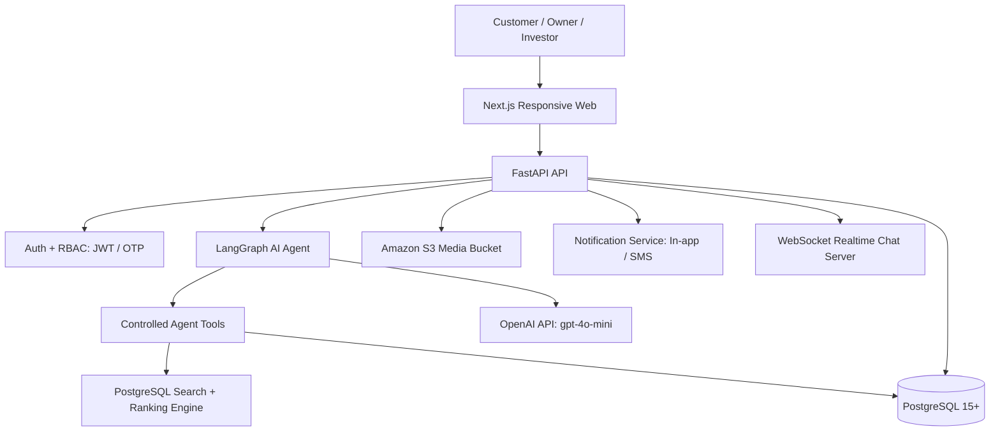

# Architecture Document: BookingBot AI Agent

> Tài liệu Kiến trúc Kỹ thuật chính thức của dự án **BookingBot AI Agent** căn cứ theo **§10 của [spec_updated.md](file:///Users/macos/AI%20Th%E1%BB%B1c%20Chi%E1%BA%BFn/P001-Discovery/P-001/.specify/spec_updated.md)**.

---

## 1. System Overview (Tổng quan Hệ thống)

**BookingBot AI Agent** là trợ lý AI-first trên nền tảng Web Responsive chuyên biệt cho hệ sinh thái bất động sản Vinhomes. Hệ thống giúp khách hàng tìm đúng căn hộ theo nhu cầu tự nhiên thông qua thuật toán lọc và xếp hạng kết hợp (Hard filter SQL + Soft scoring), tự động điều phối quy trình đặt lịch xem nhà với sự phê duyệt bắt buộc từ **Chủ nhà (Owner Approval - HITL)**, áp dụng cơ chế **Viewing Hold nguyên tử (Atomic)** để tạm khóa căn trong khung giờ xem, và tự động mở kênh chat 1-1 trực tiếp giữa Khách hàng và Chủ nhà sau khi xem nhà thành công và có Purchase Request.

---

## 2. Architecture Diagram (Sơ đồ Kiến trúc Tổng thể)



---

## 3. Core Components (Các Thành phần Lõi)

### 3.1. Frontend Tier (Next.js + TypeScript)
- **Customer Web Chat**: Giao diện hội thoại tự nhiên hỗ trợ Server-Sent Events (SSE) streaming, hiển thị Property Cards kèm điểm xếp hạng và lý do đề xuất (Explainability).
- **Owner Dashboard**: Quản lý tin đăng bán/cho thuê, nhận thông báo đẩy và phê duyệt/từ chối lịch xem nhà.
- **Investor / Operator Dashboard**: Kiểm duyệt tin đăng căn hộ mới (`PENDING_REVIEW` $\rightarrow$ `APPROVED`), giám sát Viewing Hold và xem báo cáo chỉ số vận hành.

### 3.2. Backend API Tier (FastAPI - Python 3.11+)
- **API Router & Security**: Tiếp nhận request, kiểm soát Pydantic Schemas, phân quyền RBAC (Role-based access control).
- **Booking State Machine**: Quản lý các chuyển trạng thái chặt chẽ: `REQUESTED` $\rightarrow$ `CONFIRMED` $\rightarrow$ `COMPLETED` (hoặc `REJECTED`, `CANCELLED`, `RESCHEDULE_REQUESTED`).
- **Viewing Hold Engine**: Khóa hàng nguyên tử (Atomic Row-level Lock), tạm khóa căn hộ đúng thời gian diễn ra buổi xem nhà.
- **WebSocket Chat Server**: Quản lý phòng chat trực tiếp 1-1 giữa Khách hàng và Chủ nhà với cơ chế Chat Gating (chỉ mở sau khi hoàn tất xem nhà).

### 3.3. AI Agent Layer (LangGraph)
- **Orchestration**: Quản lý StateGraph, duy trì lịch sử hội thoại đa lượt và checkpointing.
- **Requirement Extraction**: Bóc tách ngôn ngữ tự nhiên thành cấu trúc `CustomerPreference` (Ngân sách, Số phòng ngủ, Diện tích, Phân khu, Hướng ban công, Tầng, Mục đích).
- **Controlled Tools**:
  - `search_properties(criteria)`: Gọi dịch vụ lọc và xếp hạng.
  - `get_property_detail(property_id)`: Trả về thẻ chi tiết căn hộ.
  - `check_availability(property_id, datetime)`: Kiểm tra lịch trống của căn và chủ nhà.
  - `create_booking_request(property_id, slot)`: Tạo yêu cầu lịch xem.
  - `reschedule_booking(booking_id, new_slot)`: Yêu cầu đổi lịch xem.
  - `cancel_booking(booking_id)`: Khách hàng tự hủy lịch.

### 3.4. Database & Storage Layer
- **PostgreSQL 15+**: Cơ sở dữ liệu quan hệ lưu trữ Users, Properties, Bookings, Holds, Messages, Audit Logs.
- **Full-text Search & pg_trgm**: Tra cứu văn bản và tìm kiếm thuộc tính BĐS hiệu năng cao (Không dùng Vector DB / RAG trong MVP để tối ưu độ phức tạp vận hành).
- **Amazon S3**: Lưu trữ toàn bộ media hình ảnh, video căn hộ độc lập với Database.

---

## 4. Recommendation Architecture (Quy trình Xếp hạng Đề xuất 5 bước)

```text
Khách chat nhu cầu tự nhiên
          ↓
LLM trích xuất nhu cầu (Requirement Extraction)
          ↓
Cấu trúc CustomerPreference
          ↓
PostgreSQL Hard Filtering (Dự án, Căn Approved, Ngân sách trần, Số PN)
          ↓
Tập ứng viên (Candidate set)
          ↓
Soft Scoring (Giá 30%, Diện tích 20%, Thiết kế 20%, Hướng 15%, Tầng 15%)
          ↓
Priority Weighting (Trọng số theo nhu cầu nổi bật của khách)
          ↓
Proximity Scoring (Điểm khoảng cách đến tiện ích)
          ↓
Top-N Recommendations (Sắp xếp theo tổng điểm)
          ↓
Sinh lời giải thích đề xuất (Explainability)
```

---

## 5. Security & Boundary Guardrails (Ranh giới Bảo mật)

### 5.1. Security Pipeline
```text
LLM (AI Agent)
      ↓
Agent Controlled Tool Layer
      ↓
Pydantic Validation + RBAC Check
      ↓
Deterministic Business Service Layer
      ↓
PostgreSQL Database (Transaction & Row Lock)
```
- **Nguyên tắc bất biến:** Tuyệt đối không cho LLM truy cập hoặc ghi dữ liệu trực tiếp vào Database.

### 5.2. Anti-Double-Booking & Viewing Hold
```text
Kiểm tra trạng thái căn & Lịch trống
            ↓
Xác thực xung đột thời gian (Time Conflict Check)
            ↓
Giao dịch ghi nguyên tử (Atomic Write: SELECT ... FOR UPDATE)
            ↓
Chủ nhà xác nhận (Owner Approval)
            ↓
Tạo Viewing Hold (Khóa căn đúng khung giờ xem)
            ↓
Ghi Audit Log & Gửi thông báo
```

---

## 6. Design Decisions (Các Quyết định Thiết kế)

| Thành phần | Lựa chọn công nghệ | Lý do kỹ thuật căn cứ theo `spec_updated.md` |
|---|---|---|
| **Frontend** | **Next.js + TypeScript** | Hỗ trợ responsive web, kiến trúc component hiện đại, render streaming SSE cho AI chat mượt mà. |
| **Backend** | **Python + FastAPI** | Tối ưu cho AI/Data workload, async I/O cao, tự động sinh OpenAPI specs, Pydantic type-safe. |
| **Agent Framework** | **LangGraph** | Kiểm soát trạng thái đa lượt linh hoạt (stateful workflow), hỗ trợ branching, tool calling và human-in-the-loop. |
| **Database** | **PostgreSQL** | ACID transaction mạnh mẽ, hỗ trợ khóa hàng chống race condition, quản lý state machine đáng tin cậy. |
| **Search Engine** | **PostgreSQL Full-text + pg_trgm** | Đủ mạnh cho phạm vi Vinhomes trong MVP, tránh gia tăng độ phức tạp vận hành của cụm search riêng. |
| **Vector DB / RAG** | **Không dùng trong MVP** | Spec v1.0 xác định recommendation chủ yếu dựa trên structured filtering và scoring; loại bỏ chi phí RAG không cần thiết. |
| **Media Storage** | **Amazon S3** | Tách biệt hoàn toàn media tĩnh (ảnh/video căn hộ) khỏi Database, tối ưu băng thông và sao lưu. |
| **Realtime Chat** | **WebSocket qua FastAPI** | Đảm bảo kênh chat 1-1 Khách ↔ Chủ nhà tức thời, tích hợp trực tiếp trong Backend không phụ thuộc bên thứ 3. |
| **Auth / Password** | **JWT + OTP & Argon2id/bcrypt** | Bảo mật phiên đăng nhập, lưu hash an toàn, chống rò rỉ PII của khách hàng và chủ nhà. |
