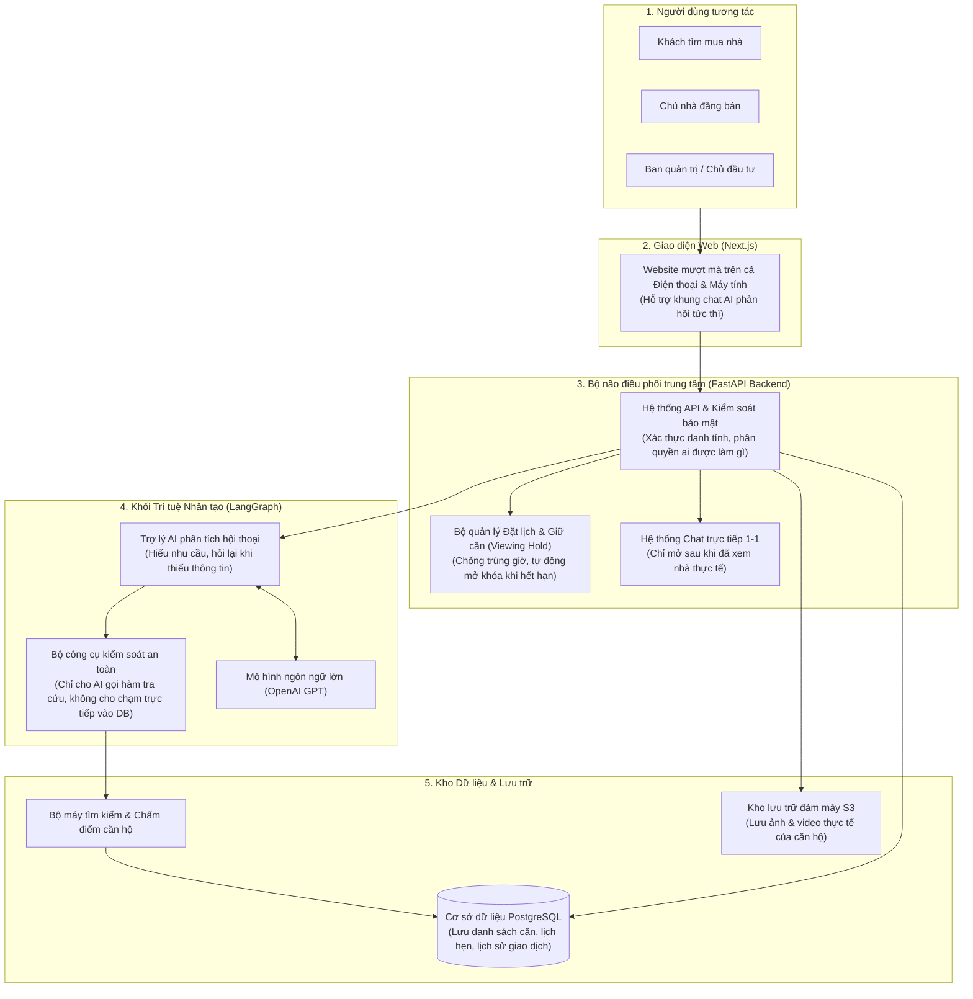

# Kiến trúc Hệ thống: BookingBot AI Agent

> **Tài liệu Kiến trúc Kỹ thuật** cho dự án **BookingBot AI Agent** — Trợ lý ảo AI chuyên biệt cho bất động sản Vinhomes, được diễn giải bằng ngôn ngữ tự nhiên, trực quan và dễ tiếp cận (Căn cứ theo mục §10 của `spec_updated.md`).

---

## 1. Hệ thống này là gì và hoạt động ra sao? (Tổng quan)

Hãy hình dung **BookingBot AI Agent** giống như một **chuyên viên tư vấn bất động sản tận tâm phục vụ 24/7** trên nền tảng Web:

1. **Khách hàng** không cần phải mò mẫm qua hàng chục bộ lọc phức tạp. Họ chỉ cần trò chuyện tự nhiên (ví dụ: *"Anh tìm căn 2 phòng ngủ bên Ocean Park, ban công thoáng mát gần công viên, tài chính tầm 4 tỷ rưỡi"*).
2. **Trợ lý AI** sẽ lắng nghe, hiểu đúng nhu cầu thực tế, tự động tra cứu kho căn hộ, chọn ra những căn phù hợp nhất và **giải thích rõ ràng vì sao căn đó lại hợp với khách**.
3. Khi khách ưng ý, AI hỗ trợ **chọn khung giờ và gửi yêu cầu đặt lịch xem nhà**.
4. **Chủ nhà (Owner)** nhận thông báo và trực tiếp bấm **Đồng ý** hoặc **Từ chối** (đảm bảo quyền quyết định luôn thuộc về con người — *Human-in-the-loop*).
5. Khi lịch xem được duyệt, hệ thống sẽ **tạm giữ căn trong đúng khung giờ đó (Viewing Hold)** để không ai khác đặt trùng.
6. Sau buổi xem nhà thực tế, nếu khách muốn tiến tới giao dịch, hệ thống mới **mở kênh chat trực tiếp 1-1** giữa khách và chủ nhà để trao đổi chi tiết mà không lo bị spam hay lộ số điện thoại từ đầu.

---

## 2. Bức tranh toàn cảnh hệ thống (Architecture Diagram)

Sơ đồ dưới đây minh họa các thành phần kết nối với nhau ra sao khi một người dùng tương tác với hệ thống:



---

## 3. Các thành phần chính — Ai làm việc gì?

### 3.1. Giao diện người dùng (Frontend - Next.js)
Đây là "bộ mặt" của hệ thống, tương thích hoàn hảo trên cả điện thoại lẫn máy tính với 3 không gian riêng biệt:
- **Dành cho Khách hàng:** Khung chat AI thông minh gõ chữ tự nhiên, phản hồi từng chữ mượt mà (streaming); hiển thị danh sách căn hộ dưới dạng thẻ trực quan kèm điểm số và lý do đề xuất.
- **Dành cho Chủ nhà:** Bảng điều khiển đơn giản để đăng bài bán nhà, xem lịch hẹn sắp tới, bấm duyệt hoặc từ chối lịch xem chỉ với một chạm.
- **Dành cho Ban quản trị (Chủ đầu tư/Operator):** Nơi kiểm duyệt từng tin đăng căn hộ trước khi được đưa lên hệ thống, theo dõi các khung giờ đang giữ căn và xem báo cáo tổng thể.

### 3.2. Bộ não điều phối trung tâm (Backend API - FastAPI)
Đóng vai trò là "người bảo vệ và người thực thi kỷ luật" của toàn hệ thống:
- **Kiểm tra an ninh & Phân quyền:** Xác minh đúng khách, đúng chủ nhà; không ai có thể xem trộm thông tin của người khác.
- **Quản lý vòng đời lịch xem nhà:** Giám sát chặt chẽ trạng thái lịch hẹn (`Chờ duyệt` $\rightarrow$ `Đã chốt` $\rightarrow$ `Đã xem xong` hoặc `Đã hủy`), tuyệt đối không để xảy ra sai sót trạng thái.
- **Khóa giữ căn nguyên tử (Viewing Hold Engine):** Khi lịch xem được duyệt, hệ thống lập tức "khóa" căn hộ trong khoảng thời gian hẹn để tránh 2 khách cùng đến xem một lúc.
- **Phòng chat an toàn (WebSocket Chat):** Kết nối phòng chat riêng tư giữa khách và chủ nhà khi đủ điều kiện, cập nhật tin nhắn theo thời gian thực mà không cần tải lại trang.

### 3.3. Trợ lý Trí tuệ Nhân tạo (AI Agent - LangGraph)
Đóng vai trò là "chuyên viên tư vấn":
- **Lắng nghe và thấu hiểu:** Bóc tách câu nói đời thường của khách thành các tiêu chí rõ ràng: Ngân sách tối đa bao nhiêu? Mấy phòng ngủ? Thích tầng cao hay thấp? Ban công hướng nào?
- **Đặt câu hỏi khéo léo:** Nếu khách nói quá chung chung (*"Tìm cho anh căn đẹp"*), AI sẽ lịch sự hỏi thêm về tầm tiền hoặc phân khu mong muốn.
- **Bộ công cụ được kiểm soát nghiêm ngặt (Safe Tools):** AI chỉ có quyền yêu cầu hệ thống tra cứu theo các tiêu chuẩn có sẵn:
  - Tra cứu căn hộ phù hợp tiêu chí (`search_properties`).
  - Xem chi tiết hình ảnh, tiện ích một căn cụ thể (`get_property_detail`).
  - Kiểm tra xem căn hộ và chủ nhà có rảnh vào giờ khách muốn không (`check_availability`).
  - Gửi yêu cầu đặt lịch hẹn (`create_booking_request`).
  - Đổi lịch hoặc hủy lịch theo ý khách (`reschedule_booking`, `cancel_booking`).

### 3.4. Kho lưu trữ thông tin (Database & Cloud Storage)
- **PostgreSQL:** "Sổ cái" an toàn lưu trữ toàn bộ người dùng, căn hộ, lịch đặt, tin nhắn và lịch sử kiểm toán (Audit Log).
- **Bộ tìm kiếm văn bản tích hợp:** Cho phép gõ tìm tên tòa, phân khu, tiện ích với tốc độ cực nhanh mà không cần cài thêm các hệ thống tìm kiếm cồng kềnh.
- **Kho lưu trữ Amazon S3:** Nơi cất giữ hình ảnh giấy tờ, ảnh chụp và video căn hộ chất lượng cao, giúp hệ thống hoạt động nhẹ nhàng và tải ảnh nhanh.

---

## 4. Cơ chế gợi ý thông minh — AI tìm nhà cho bạn như thế nào?

Thay vì gợi ý bừa bãi hoặc phụ thuộc vào việc "đoán mò" của AI, hệ thống áp dụng **quy trình 5 bước minh bạch, chính xác và có thể kiểm chứng**:

```text
1. Khách nhắn nhu cầu bằng ngôn ngữ tự nhiên
   ("Tìm cho anh căn 2PN bên Smart City, view thoáng, tài chính dưới 4 tỷ")
                       ↓
2. AI chắt lọc các tiêu chuẩn cốt lõi
   (Dự án: Smart City | Số PN: 2 | Ngân sách trần: 4 tỷ | Ưu tiên: View thoáng)
                       ↓
3. Lọc cứng trong cơ sở dữ liệu (Hard Filtering)
   (Chỉ lấy các căn ĐÃ KIỂM DUYỆT, đúng 2PN, giá <= 4 tỷ. Căn nào không thỏa mãn loại ngay lập tức)
                       ↓
4. Chấm điểm độ hợp theo sở thích (Soft Scoring & Weighting)
   - Độ hợp về giá (30%)
   - Độ rộng diện tích (20%)
   - Thiết kế & Nội thất (20%)
   - Hướng ban công & Tầm view (15%)
   - Khoảng tầng phù hợp (15%)
   - Khoảng cách tới công viên, trường học, bệnh viện...
                       ↓
5. Chọn ra Top căn điểm cao nhất & Giải thích lý do
   ("Em đề xuất căn này vì nằm đúng tầm giá 3.8 tỷ của anh, ban công Đông Nam mát mẻ và chỉ cách công viên trung tâm 200m")
```

> **Điểm ưu việt:** Khách hàng luôn biết rõ **tại sao căn nhà này lại được gợi ý cho mình**, tạo cảm giác an tâm và tin tưởng tuyệt đối.

---

## 5. Ranh giới Bảo mật — Đảm bảo an toàn tuyệt đối cho người dùng

### 5.1. Bức tường bảo vệ cơ sở dữ liệu (Security Pipeline)
Một nguyên tắc bất di bất dịch của hệ thống: **AI không bao giờ được phép đọc hoặc ghi trực tiếp vào cơ sở dữ liệu.**

```text
Khách trò chuyện với AI Agent
              ↓
AI Agent chỉ được gọi các "Hàm công cụ" định sẵn
              ↓
Bộ lọc bảo mật kiểm tra quyền (Người dùng này là ai? Có quyền làm việc này không?)
              ↓
Bộ quy tắc nghiệp vụ xử lý chính xác tuyệt đối (Business Logic)
              ↓
Ghi nhận an toàn vào Cơ sở dữ liệu
```
*Điều này giúp triệt tiêu hoàn toàn rủi ro AI bị "ảo giác" (hallucination), bị lừa (prompt injection) hay tự ý sửa đổi giá bán/dữ liệu của chủ nhà.*

### 5.2. Chống đặt trùng lịch & Giữ căn thông minh (Viewing Hold)
Giống như cơ chế giữ ghế tạm thời khi bạn đặt vé xem phim:
1. Khi khách chọn giờ xem, hệ thống kiểm tra lịch trống của căn và chủ nhà.
2. Khi chủ nhà xác nhận đồng ý, hệ thống kích hoạt chế độ **Viewing Hold** — căn hộ được đánh dấu tạm giữ trong khung giờ đó.
3. Trong suốt thời gian giữ căn, không một ai khác có thể đặt lịch trùng vào khung giờ này.
4. Khi buổi xem nhà kết thúc hoặc nếu lịch bị hủy, trạng thái giữ căn sẽ tự động giải phóng ngay lập tức.

### 5.3. Bảo vệ quyền riêng tư & Ngăn chặn tin nhắn rác
- Khách hàng và Chủ nhà **không thể tự tiện nhắn tin làm phiền nhau ngay từ đầu**.
- Kênh chat 1-1 chỉ được tự động kích hoạt sau khi:
  1. Buổi xem nhà thực tế đã diễn ra thành công (`COMPLETED`).
  2. Khách hàng gửi yêu cầu muốn mua/đàm phán (`Purchase Request`).
- Điều này loại bỏ hoàn toàn tình trạng môi giới ảo, spam quảng cáo hoặc quấy rầy chủ nhà.

---

## 6. Bảng tổng hợp công nghệ & Lý do lựa chọn

| Thành phần | Công nghệ lựa chọn | Giải thích lý do lựa chọn một cách dễ hiểu |
|---|---|---|
| **Giao diện Web** | **Next.js (React) + TypeScript** | Giúp website hiển thị mượt mà trên cả điện thoại lẫn máy tính; hỗ trợ khung chat phản hồi mượt từng chữ; hạn chế tối đa lỗi lập trình. |
| **Hệ thống Backend** | **Python + FastAPI** | Tốc độ xử lý cực nhanh, tương thích tốt nhất với các thư viện Trí tuệ nhân tạo (AI), tự động kiểm tra tính hợp lệ của dữ liệu đầu vào. |
| **Điều phối AI** | **LangGraph** | Giúp quản lý luồng hội thoại nhiều bước thông minh, nhớ bối cảnh trò chuyện và biết khi nào cần dừng lại hỏi ý kiến con người. |
| **Cơ sở dữ liệu** | **PostgreSQL** | Hệ quản trị cơ sở dữ liệu chuẩn mực hàng đầu thế giới, đảm bảo dữ liệu giao dịch chính xác 100%, chống trùng lặp lịch hẹn hoàn hảo. |
| **Công cụ tìm kiếm** | **PostgreSQL Full-text Search** | Tận dụng sẵn sức mạnh tìm kiếm văn bản của PostgreSQL; đáp ứng xuất sắc nhu cầu của dự án mà không cần tốn thêm chi phí dựng cụm máy chủ tìm kiếm riêng. |
| **Cơ sở dữ liệu Vector (Vector DB)** | **Chưa dùng trong bản MVP** | Vì giai đoạn này hệ thống ưu tiên lọc chính xác theo tiêu chí thực tế (giá, phòng ngủ, vị trí) chứ không cần tìm kiếm tài liệu chung chung; tiết kiệm chi phí vận hành. |
| **Lưu trữ ảnh & video** | **Amazon S3** | Lưu toàn bộ hình ảnh và video thực tế của căn hộ lên đám mây dung lượng lớn, giúp website tải nhanh mà không làm nặng cơ sở dữ liệu. |
| **Kênh Chat trực tiếp** | **WebSocket tích hợp sẵn** | Nhắn tin tức thời giữa khách và chủ nhà giống như Zalo/Messenger thu nhỏ, bảo mật và không bị phụ thuộc vào dịch vụ bên thứ ba. |
| **Bảo mật đăng nhập** | **Mã OTP + Khóa token JWT & Mã hóa mật khẩu chuẩn cao** | Đăng nhập tiện lợi bằng số điện thoại/OTP, mã hóa mật khẩu nhiều lớp đảm bảo thông tin cá nhân của người dùng luôn được an toàn tuyệt đối. |

---

> **Tóm lại:** Kiến trúc của **BookingBot AI Agent** kết hợp hài hòa giữa **sự thông minh, thân thiện của Trí tuệ nhân tạo (AI)** và **sự chặt chẽ, an toàn, chuẩn xác của Hệ thống quản trị nghiệp vụ truyền thống**.
