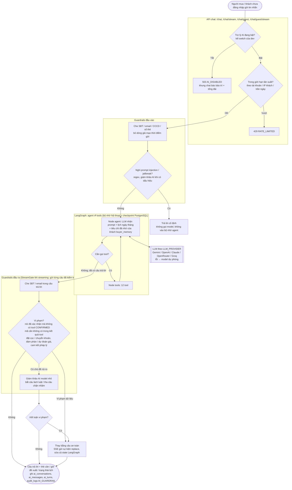
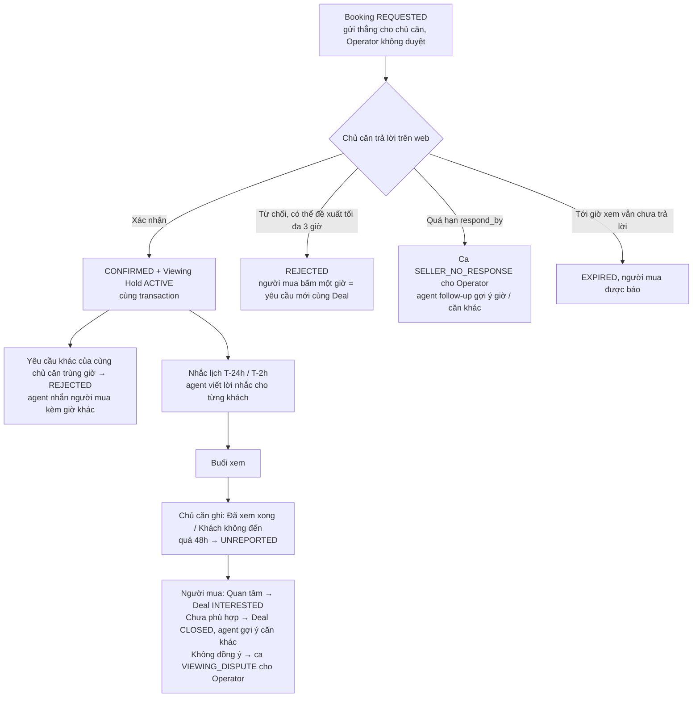

# Agent Flow Diagram

> Một lượt chat của người mua đi qua **BookingBot AI Agent** như thế nào, theo code hiện tại
> (`src/api/routers/chat.py` → `src/services/chat_service.py` → `src/agents/graph.py` / `tools.py` / `guardrails.py`).
> Đặc tả: [`.specify/spec_final.md`](../.specify/spec_final.md); quy tắc đang chạy: [`CLAUDE.md`](../CLAUDE.md).

## 1. Một lượt chat (từ tin nhắn tới câu trả lời)

## 2. Tool của agent và đường đi tới Database

```mermaid
graph LR
    subgraph Read["Tool đọc"]
        T1[list_projects]
        T2[search_properties<br/>SQL hard filter + soft scoring]
        T3[get_property_detail]
        T4[get_seller_status<br/>không trả PII]
        T5[check_seller_availability]
        T6[check_property_availability]
        T7[get_deal_status]
        T8[get_booking_status]
    end
    subgraph Act["Tool hành động"]
        A1[create_viewing_request<br/>tạo / tái dùng Deal + Booking REQUESTED]
        A2[cancel_viewing]
        A3[reschedule_viewing]
        A4[create_human_escalation]
    end

    Read --> API[agent_api.py<br/>quyền của chính khách đang chat]
    Act --> API

    subgraph Pipeline["Service layer (cùng pipeline với web)"]
        P1[1. Pydantic validation]
        P2[2. Xác thực + RBAC<br/>khách chưa đăng nhập → UNAUTHENTICATED]
        P3[3. Business rules: căn AVAILABLE, người bán VERIFIED,<br/>Deal chưa đóng, đúng trạng thái, đúng khung giờ,<br/>báo trước tối thiểu VIEWING_MIN_NOTICE_MINUTES]
        P4[4. Transaction + khóa dòng + exclusion constraint]
        P5[5. Ghi Deal / Booking, audit_logs, notifications]
        P1 --> P2 --> P3 --> P4 --> P5
    end
    API --> P1
    P5 --> DB[(PostgreSQL)]
    P2 -. lỗi có cấu trúc .-> RES[Kết quả tool trả cho agent]
    P3 -. lỗi có cấu trúc .-> RES
    P5 --> RES
```

Không có tool xác nhận lịch, tạo / nhả hold, gửi thông báo hay đọc SĐT/email: xác nhận lịch là việc của chủ căn
trên web, hold do Service tạo trong cùng transaction xác nhận và job nền nhả, thông báo do Service gửi. Agent chỉ
báo "đã gửi yêu cầu" sau khi tool trả kết quả thành công từ Backend. Khách chưa đăng nhập mà muốn đặt lịch → tool
trả `UNAUTHENTICATED`, web hiện khung đăng ký SĐT + OTP rồi gửi tiếp yêu cầu.

## 3. Sau khi agent gửi yêu cầu xem (ngoài lượt chat)

MVP kết thúc tại buổi xem: Purchase Request, chat trực tiếp Người mua ↔ Chủ căn và các bước giao dịch là post-MVP.
