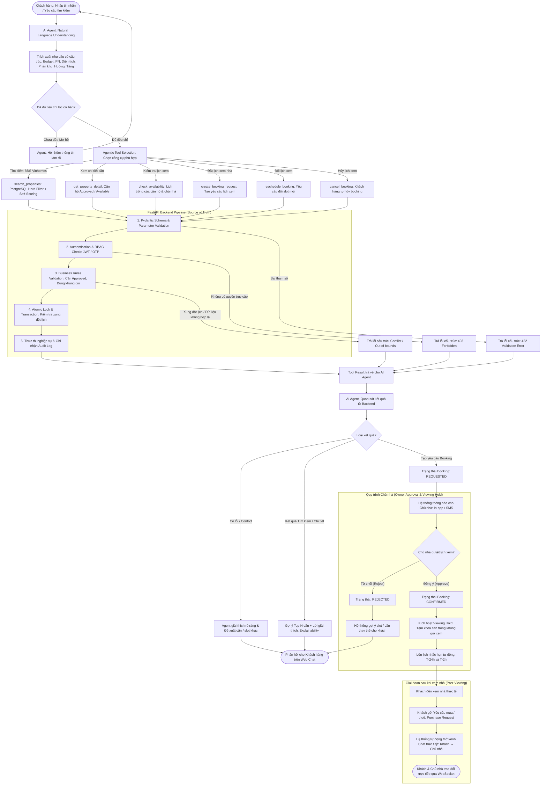

# Agent Flow Diagram

> Sơ đồ luồng hoạt động của **BookingBot AI Agent** theo đặc tả [spec_updated.md](file:///Users/macos/AI%20Th%E1%BB%B1c%20Chi%E1%BA%BFn/P001-Discovery/P-001/.specify/spec_updated.md): Từ bóc tách nhu cầu tự nhiên, tìm kiếm/xếp hạng căn Vinhomes, kiểm tra lịch trống, tạo yêu cầu booking, quy trình Chủ nhà (Owner) phê duyệt, kích hoạt Viewing Hold, nhắc lịch đến mở kênh chat trực tiếp sau khi xem nhà.

