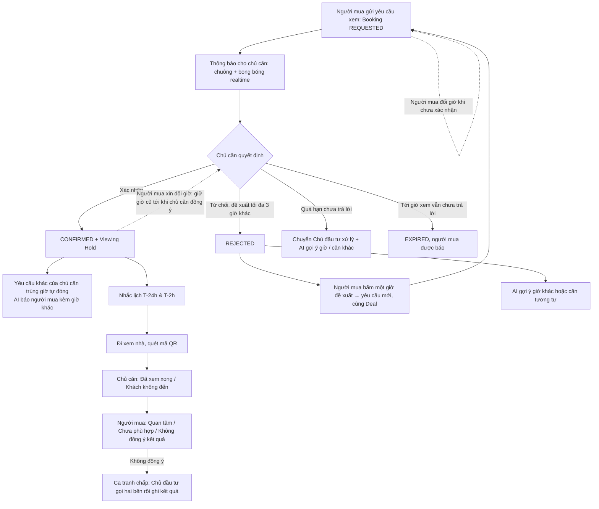
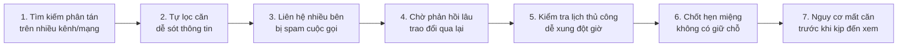

# Customer Journey Diagram (Hành trình Khách hàng)

> So sánh **hiện trạng truyền thống** và **hành trình với BookingBot AI Agent** theo hệ thống đang chạy
> (đặc tả: §4.4 của [`.specify/spec_final.md`](../.specify/spec_final.md); quy tắc: [`CLAUDE.md`](../CLAUDE.md)).
> MVP kết thúc tại buổi xem nhà; các bước sau đó (Purchase Request, chat trực tiếp, giao dịch) là post-MVP.

---

## 1. Hành trình người mua với BookingBot AI Agent

```mermaid
flowchart LR
    J1["1. Vào /buyer<br/>chat ngay với AI<br/>(chưa cần tài khoản)"] --> J2["2. AI bóc tách nhu cầu<br/>ngân sách, PN, dự án,<br/>hướng, tầng — hỏi lại khi thiếu"]
    J2 --> J3["3. Tìm & xếp hạng<br/>SQL hard filter + soft score<br/>chỉ căn AVAILABLE đã xác thực"]
    J3 --> J4["4. Thẻ căn + lý do,<br/>ảnh, chi tiết căn"]
    J4 --> J5["5. AI đề xuất giờ xem<br/>khớp lịch trống chủ căn<br/>(sớm nhất sau 2 giờ)"]
    J5 --> J6["6. Đăng ký SĐT + OTP<br/>(nếu là khách)<br/>→ Deal ID + yêu cầu REQUESTED"]
    J6 --> J7["7. Chủ căn xác nhận<br/>(Owner Approval)"]
    J7 --> J8["8. Viewing Hold<br/>+ mã QR vào cửa<br/>(trang Hoạt động)"]
    J8 --> J9["9. Nhắc lịch<br/>T-24h & T-2h"]
    J9 --> J10["10. Xem nhà<br/>chủ căn ghi nhận kết quả"]
    J10 --> J11["11. Người mua: Quan tâm /<br/>Chưa phù hợp<br/>(→ AI gợi ý căn khác)"]
```

---

## 2. Phân nhánh tại bước chủ căn trả lời

---

## 3. Hiện trạng truyền thống trước đây (Traditional Painful Journey)

---

## 4. Bảng so sánh Before vs After

| Tiêu chí | Hiện trạng truyền thống (Before) | Với BookingBot AI Agent (After) |
|---|---|---|
| **Kênh tìm kiếm** | Phân tán nhiều website, mạng xã hội, tin rác | Một khung AI Chat, chỉ căn Vinhomes đã xác thực chủ sở hữu (sổ đỏ) và được Chủ đầu tư duyệt tin |
| **Cách tìm căn** | Khách tự mò bộ lọc phức tạp | Chat ngôn ngữ tự nhiên, AI bóc tách nhu cầu và chấm điểm phù hợp (Hard filter + Soft score), nhớ tiêu chí cho lần sau |
| **Bảo mật & phiền hà** | Bị nhiều môi giới gọi điện làm phiền | Chủ căn chỉ thấy họ tên + nhu cầu của người mua, SĐT/email luôn ẩn; AI che PII trong chat |
| **Xác nhận lịch** | Nhắn tin/gọi điện thủ công, mất hàng giờ đến hàng ngày | Yêu cầu chuẩn hóa kèm Deal ID, chủ căn xác nhận / từ chối kèm giờ khác trên web; quá hạn thì Chủ đầu tư can thiệp |
| **Giữ căn khi xem** | Không có cơ chế giữ căn; dễ trùng lịch | **Viewing Hold nguyên tử**: tạm khóa căn đúng khung giờ xem; chủ căn không thể có 2 lịch đã xác nhận trùng giờ |
| **Sau buổi xem** | Khó kết nối lại hoặc phải qua nhiều trung gian | Ghi nhận kết quả, người mua báo Quan tâm (chủ căn được báo) hoặc nhận gợi ý căn khác; tranh chấp có Chủ đầu tư xử lý. Chat trực tiếp / Purchase Request: post-MVP |
