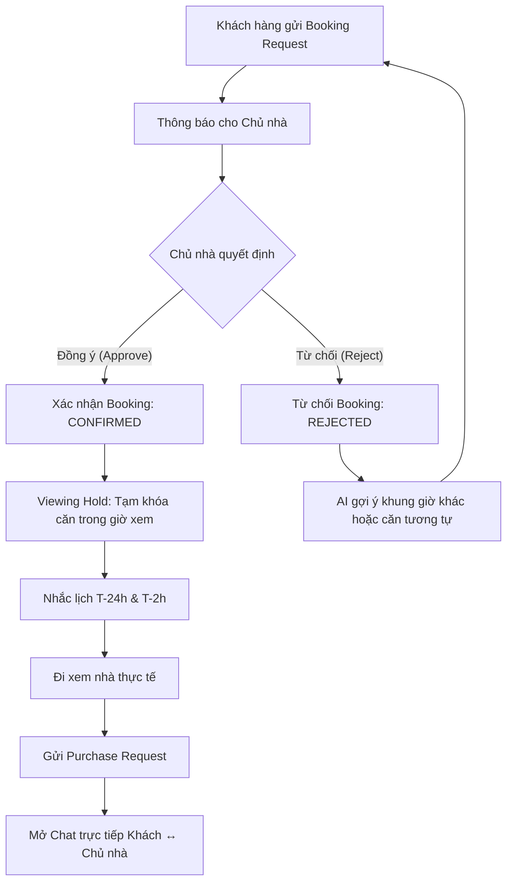
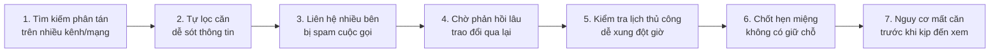

# Customer Journey Diagram (Hành trình Khách hàng)

> So sánh **Hiện trạng truyền thống (Current Painful Journey)** và **Hành trình giải pháp mới với BookingBot AI Agent (Target Journey theo §4.4 của [spec_updated.md](file:///Users/macos/AI%20Th%E1%BB%B1c%20Chi%E1%BA%BFn/P001-Discovery/P-001/.specify/spec_updated.md))**.

---

## 1. Hành trình Khách hàng mới với BookingBot AI Agent (Target Journey - §4.4)

Sơ đồ tuần tự theo phong cách ngang (Horizontal Flowchart) thể hiện toàn bộ quy trình khép kín: từ lúc tìm kiếm, nhận đề xuất, đặt lịch, chủ nhà phê duyệt, giữ căn, xem nhà cho tới khi gửi yêu cầu mua và mở kênh chat trực tiếp.

```mermaid
flowchart LR
    J1["1. Landing Page<br/>& Mở AI Chat"] --> J2["2. Thu thập nhu cầu<br/>(Ngân sách, PN, Khu vực)"]
    J2 --> J3["3. Tìm kiếm, Lọc &<br/>Xếp hạng (Hard+Soft)"]
    J3 --> J4["4. Gợi ý Thẻ căn hộ<br/>(Property Cards + Lý do)"]
    J4 --> J5["5. Xem chi tiết căn<br/>& Chọn khung giờ xem"]
    J5 --> J6["6. Kiểm tra Lịch trống<br/>& Tạo Booking Request"]
    J6 --> J7["7. Chủ nhà duyệt lịch<br/>(Owner Approval)"]
    J7 --> J8["8. Kích hoạt Viewing Hold<br/>(Tạm khóa căn giờ xem)"]
    J8 --> J9["9. Nhắc lịch tự động<br/>(T-24h & T-2h)"]
    J9 --> J10["10. Khách đến xem nhà<br/>& Gửi Purchase Request"]
    J10 --> J11["11. Mở kênh Chat 1-1<br/>Khách ↔ Chủ nhà"]
```

---

## 2. Phân nhánh chi tiết tại điểm phê duyệt của Chủ nhà (Owner Decision Fork)

---

## 3. Hiện trạng truyền thống trước đây (Traditional Painful Journey)

---

## 4. Bảng so sánh Before vs After

| Tiêu chí | Hiện trạng truyền thống (Before) | Với BookingBot AI Agent (After) |
|---|---|---|
| **Kênh tìm kiếm** | Phân tán nhiều website, mạng xã hội, tin rác | Một giao diện AI Chat tập trung, chuyên biệt cho căn hộ Vinhomes |
| **Cách tìm căn** | Khách tự mò bộ lọc phức tạp | Chat ngôn ngữ tự nhiên, AI bóc tách nhu cầu và tự tính điểm phù hợp (Hard filter + Soft score) |
| **Bảo mật & phiền hà** | Bị nhiều môi giới gọi điện làm phiền | Không spam cuộc gọi, thông tin liên lạc được bảo vệ, chỉ kết nối đúng chủ nhà |
| **Xác nhận lịch** | Nhắn tin/gọi điện thủ công, mất hàng giờ đến hàng ngày | Tạo request chuẩn hóa, chủ nhà nhận thông báo và duyệt nhanh qua hệ thống |
| **Giữ căn khi xem** | Không có cơ chế giữ căn; dễ bị khách khác xem trước hoặc bán mất | **Viewing Hold nguyên tử (Atomic)**: Tạm khóa căn đúng khung giờ xem |
| **Sau buổi xem** | Khó kết nối lại hoặc phải qua nhiều trung gian | Gửi **Purchase Request** tự động mở kênh chat 1-1 trực tiếp với chủ nhà để đàm phán |
