# Current Journey Diagram (Hiện trạng Hành trình Khách hàng)

> Minh họa 9 bước hiện trạng hành trình tìm kiếm và đặt lịch xem BĐS của khách hàng theo **Mục 1.2 trong [spec.md](file:///Users/macos/AI%20Th%E1%BB%B1c%20Chi%E1%BA%BFn/P001-Discovery/P-001/.specify/spec.md)**.

```mermaid
flowchart LR
    S1["1. Khách tự tìm kiếm<br/>BĐS trên nhiều kênh"] --> S2["2. Khách xác định căn<br/>có vẻ phù hợp"]
    S2 --> S3["3. Khách liên hệ Sale"]
    S3 --> S4["4. Sale tư vấn &<br/>kiểm tra căn"]
    S4 --> S5["5. Khách / Sale trao đổi<br/>tìm thời gian xem"]
    S5 --> S6["6. Chủ nhà kiểm tra<br/>availability nhiều nguồn lực"]
    S6 --> S7["7. Hai bên<br/>xác nhận lịch"]
    S7 --> S8["8. Khách nhận thông tin<br/>lịch & đi xem"]
    S8 --> S9["9. Cập nhật booking<br/>(Completed / No-show)"]
```

