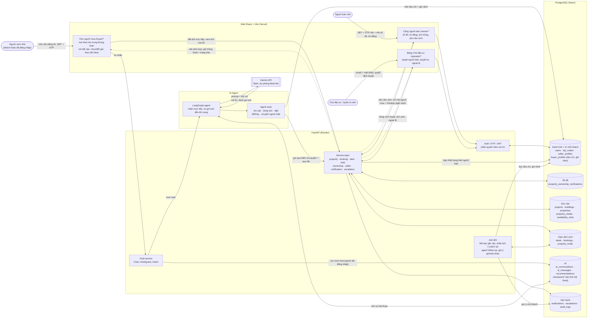
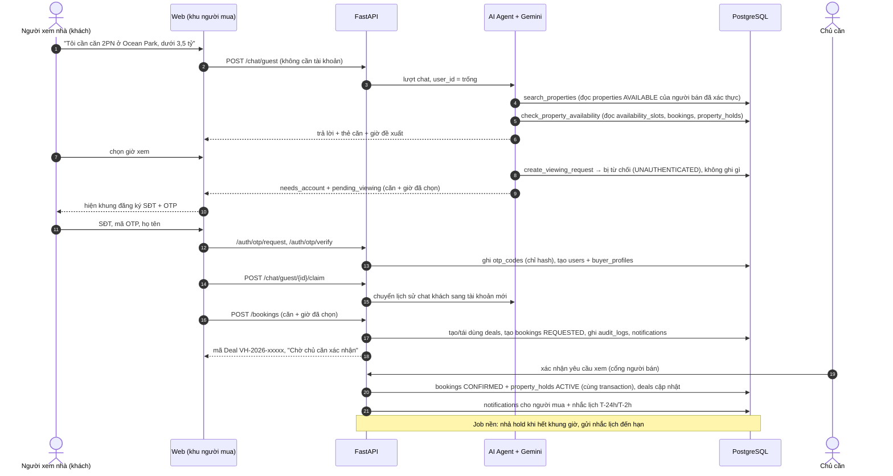
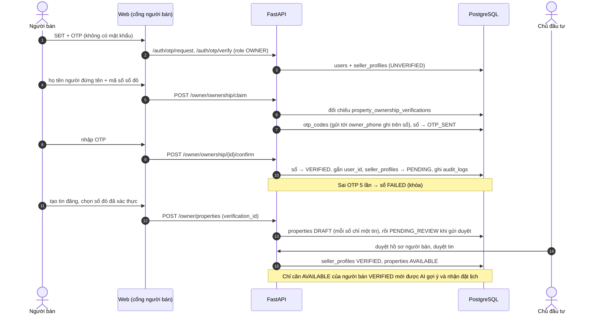

# Data Flow Diagram (Sơ đồ Luồng Dữ liệu)

> Dữ liệu đi qua hệ thống **BookingBot AI Agent** như thế nào, theo đúng code hiện tại (nhánh `feature/Baor-app`):
> ai gửi gì, đi qua lớp nào, được ghi vào bảng nào và ai được đọc lại. Database PostgreSQL là nguồn sự thật;
> AI Agent không truy cập DB trực tiếp mà luôn đi qua Tool Layer → Service Layer.

---

## 1. Tổng quan luồng dữ liệu (Level 1)

**Đọc sơ đồ:** người mua chỉ nói chuyện với AI Agent; mọi thao tác của agent (tìm căn, khớp lịch, đặt lịch)
đều đi qua cùng Service layer với web, nên cùng kiểm tra quyền và quy tắc nghiệp vụ. Chủ căn không bao giờ
nhận số điện thoại hay email của người mua (privacy Level 1).

---

## 2. Giải thích các thành phần

### 2.1. Tác nhân (hình bo tròn)

| Thành phần | Là ai | Đưa vào hệ thống | Nhận lại |
|---|---|---|---|
| **Người xem nhà** | Khách mua. Có thể chat ngay với tư cách khách (chưa có tài khoản); chỉ khi gửi yêu cầu xem nhà mới phải đăng ký SĐT + OTP | Nhu cầu bằng lời, lựa chọn căn/giờ, SĐT + OTP | Căn phù hợp, giờ đề xuất, mã Deal, trạng thái lịch xem, tin nhắn chủ động của agent |
| **Người bán nhà** | Chủ căn muốn bán. Chỉ đăng nhập bằng SĐT + OTP (backend chặn mật khẩu) | Tên người đứng tên + mã sổ đỏ, tin đăng, lịch trống, xác nhận/từ chối yêu cầu xem | Yêu cầu xem chỉ có mã người mua + khoảng ngân sách (không có SĐT/email) |
| **Chủ đầu tư / Quản trị viên** | Lớp tin cậy (Trust Layer): duyệt người bán, duyệt tin, xử lý ngoại lệ. Đăng nhập bằng email + mật khẩu; không duyệt từng lịch xem | Quyết định duyệt / từ chối, xử lý ngoại lệ | Hàng chờ duyệt, toàn bộ lịch xem, hàng ngoại lệ |

### 2.2. Giao diện web (React + Vite, deploy trên Vercel)

- **Khu người mua `/buyer/*`**: trang giới thiệu → khung chat với AI Agent. Mọi thao tác nằm trong khung chat
  dưới dạng thẻ: chi tiết căn, chọn giờ xem, đổi giờ, theo dõi trạng thái Deal, "Lịch xem của tôi"; mỗi thẻ có
  nút "← Quay lại". Bên phải là danh sách căn phù hợp. Web tự hỏi lại backend mỗi 30 giây để agent báo ngay
  trong chat khi chủ căn xác nhận / từ chối / đổi giờ. Link cũ (`/buyer/properties/:id`, `/buyer/bookings`) đều
  chuyển về khung chat.
- **Cổng người bán `/owner/*`**: xác thực sổ đỏ, tạo/sửa tin đăng, khai báo lịch trống, xác nhận hoặc từ chối
  yêu cầu xem (đây là bước "Owner xác nhận" bắt buộc — agent không làm thay được).
- **Bảng Chủ đầu tư `/operator/*`**: duyệt hồ sơ người bán, duyệt tin đăng, theo dõi lịch xem, xử lý hàng ngoại lệ.

Web chỉ gọi REST API (`openapi-fetch`, kiểu dữ liệu sinh từ OpenAPI của backend); không có logic nghiệp vụ
nào chỉ nằm ở web.

### 2.3. Backend FastAPI (deploy trên Render)

- **Auth: OTP / JWT** (`src/services/auth_service.py`, `otp_service.py`): gửi và kiểm tra OTP (chỉ lưu hash,
  hết hạn 5 phút, sai 5 lần thì hủy), cấp JWT, phân quyền theo vai trò Người mua / Người bán / Chủ đầu tư.
  Đăng ký phân biệt với đăng nhập: SĐT đã có tài khoản thì không cho đăng ký lại.
- **Chat service** (`src/api/routers/chat.py`, `chat_service.py`): nhận tin nhắn của web và chuyển cho agent.
  `/chat/guest` cho khách chưa có tài khoản; `/claim` chuyển lịch sử chat khách sang tài khoản vừa tạo;
  `/chat` lưu lượt chat của người đã đăng nhập vào `ai_conversations` / `ai_messages`.
- **Service layer** (`src/services/*_service.py`): nơi duy nhất ghi dữ liệu nghiệp vụ. Cả web lẫn agent đều đi
  qua đây, nên cùng một bộ kiểm tra: đúng quyền, căn `AVAILABLE`, người bán `VERIFIED`, Deal chưa đóng, đúng
  trạng thái, đúng khung giờ. Thao tác Deal + Booking + Hold chạy trong một transaction, có khóa dòng và
  ràng buộc chống trùng giờ của PostgreSQL; mọi thao tác quan trọng ghi `audit_logs` và tạo `notifications`.
  - `property` tìm căn (lọc cứng bằng SQL + chấm điểm mức phù hợp), `booking` đặt / đổi giờ / hủy / xác nhận,
    `deal` tạo mã `VH-yyyy-xxxxx` và cập nhật trạng thái Deal, `hold` giữ căn cho buổi xem sau khi chủ căn xác nhận,
    `ownership` đối chiếu sổ đỏ + OTP, `seller` trạng thái người bán, `notification` thông báo trong web,
    `escalation` hàng ngoại lệ cho người thật.
- **Job nền** (`src/jobs.py`, chạy trong cùng tiến trình API, mặc định mỗi 60 giây):
  nhả giữ căn khi hết khung giờ xem; gửi nhắc lịch T-24h / T-2h (agent viết lại lời nhắc cho từng khách);
  chuyển cho người thật các yêu cầu chủ căn để quá lâu không trả lời; agent follow-up — gợi ý giờ hoặc căn khác
  khi yêu cầu bị từ chối / chưa được trả lời.

### 2.4. AI Agent

- **LangGraph agent** (`src/agents/graph.py`, `prompts.py`): nhận mục tiêu của khách ("đặt giúp tôi chiều mai")
  và tự gọi tool nhiều bước cho tới khi xong hoặc cần hỏi lại. Prompt có sẵn lịch ngày tháng (tránh đặt nhầm ngày)
  và tiêu chí khách đã nói ở các lần trước (`buyer_memory`). Bộ nhớ hội thoại lưu trong PostgreSQL qua checkpoint
  của LangGraph, khởi động lại server không mất.
- **Agent tools** (`src/agents/tools.py` → `src/services/agent_api.py`): 12 tool — `list_projects`,
  `search_properties`, `get_property_detail`, `get_seller_status`, `check_seller_availability`,
  `check_property_availability`, `get_deal_status`, `get_booking_status`, `create_viewing_request`,
  `cancel_viewing`, `reschedule_viewing`, `create_human_escalation`. Tool chỉ gọi Service layer với đúng
  quyền của khách đang chat; không có tool xác nhận lịch hay tạo giữ căn (việc của chủ căn), không có tool đọc
  SĐT/email. Khách chưa đăng nhập mà muốn đặt lịch → tool trả lỗi, web hiện khung đăng ký và gửi tiếp yêu cầu.
- **Gemini API** (`src/services/llm.py`): mô hình `gemini-flash-latest`, tự chuyển sang `gemini-flash-lite-latest`
  khi lỗi / quá tải. LLM chỉ nhận prompt + lịch sử và trả lời hoặc yêu cầu gọi tool; nó không bao giờ chạm DB.
  Lỗi LLM → khách thấy thông báo gián đoạn, không có hành động nào được ghi.

### 2.5. Kho dữ liệu (PostgreSQL, deploy trên Neon)

| Nhóm | Bảng | Dùng để |
|---|---|---|
| **Danh tính + trí nhớ khách** | `users`, `otp_codes`, `seller_profiles`, `buyer_profiles` | Tài khoản, mã OTP, trạng thái xác thực người bán, tiêu chí + giờ rảnh khách đã nói (để agent nhớ ở lần chat sau) |
| **Sổ đỏ** | `property_ownership_verifications` | Dữ liệu sổ đỏ của Chủ đầu tư để đối chiếu khi người bán chứng minh sở hữu |
| **Kho căn** | `projects`, `buildings`, `properties`, `property_media`, `availability_slots` | Căn đang bán, ảnh, lịch trống của chủ căn |
| **Giao dịch xem** | `deals`, `bookings`, `property_holds` | Mỗi cặp Người mua + Căn có một Deal; lịch xem và trạng thái; giữ căn trong khung giờ xem đã xác nhận |
| **AI** | `ai_conversations`, `ai_messages`, `recommendations`, `checkpoint*` | Lịch sử chat, căn đã gợi ý, bộ nhớ hội thoại của agent |
| **Vận hành** | `notifications`, `escalations`, `audit_logs` | Thông báo trong web, hàng ngoại lệ cho người thật, nhật ký truy vết |

Chi tiết ai ghi / ai đọc từng bảng ở mục 5.

### 2.6. Ý nghĩa các mũi tên

- **Mũi tên liền**: dữ liệu được gửi vào để xử lý hoặc ghi (yêu cầu, lệnh gọi tool, ghi DB). `<-->` là vừa đọc vừa ghi.
- **Mũi tên đứt**: dữ liệu trả về cho web hiển thị. Đáng chú ý là chiều về Cổng người bán chỉ mang mã người mua
  + khoảng ngân sách (bảo vệ thông tin cá nhân, AC-03).

---

## 3. Luồng chính: người mới chat → đặt lịch → chủ căn xác nhận

---

## 4. Luồng người bán: xác thực sổ đỏ → đăng tin → Chủ đầu tư duyệt

---

## 5. Kho dữ liệu: ai ghi, ai đọc

| Kho (bảng) | Ghi bởi | Đọc bởi | Ghi chú |
|---|---|---|---|
| `users`, `otp_codes` | Auth (đăng nhập/đăng ký OTP) | Auth, mọi API cần đăng nhập | OTP chỉ lưu hash, hết hạn 5 phút, sai 5 lần thì hủy |
| `buyer_profiles` | Auth khi tạo người mua; agent ghi tiêu chí + giờ rảnh khi tìm căn / khớp lịch | Booking (chủ căn chỉ thấy ngân sách); prompt của agent ở các cuộc chat sau; job follow-up | Không chứa SĐT/email |
| `seller_profiles` | Auth, xác thực sổ đỏ, Chủ đầu tư | Duyệt tin, tìm căn | Chỉ người bán VERIFIED mới có căn được gợi ý |
| `property_ownership_verifications` | Seed từ dữ liệu Chủ đầu tư; xác thực sổ đỏ | Xác thực sổ đỏ, tạo tin đăng | Mỗi sổ gắn đúng một tin (`properties.verification_id`) |
| `properties`, `property_media` | Người bán; Chủ đầu tư duyệt | Agent (tìm căn), web | Giấy tờ sở hữu không bao giờ công khai |
| `availability_slots` | Người bán (lịch trống) | Khớp lịch | Seed bổ sung lịch demo 7 ngày tới |
| `deals`, `bookings` | Đặt lịch (web hoặc agent), chủ căn xác nhận/từ chối | Người mua, chủ căn, Chủ đầu tư | Chặn đặt trùng giờ bằng ràng buộc DB |
| `property_holds` | Khi chủ căn xác nhận; job nền nhả hold | Khớp lịch | Giữ căn cho buổi xem, không phải giữ để mua |
| `ai_conversations`, `ai_messages`, `recommendations` | Chat service (người đã đăng nhập) | Lịch sử chat | |
| `checkpoints`, `checkpoint_*` | LangGraph (bộ nhớ hội thoại, cả chat khách) | Agent mỗi lượt chat | Bảng do LangGraph tự tạo/migrate, Alembic bỏ qua |
| `notifications` | Booking, sổ đỏ, duyệt tin, job nhắc lịch, agent follow-up (`AGENT_FOLLOWUP`, `AGENT_NEW_MATCH`) | Chuông thông báo trên web (cả khu người mua) | Chưa có SMS/Zalo; mỗi gợi ý của agent gửi một lần (`dedupe_key`) |
| `escalations` | Agent (`create_human_escalation`) | Chủ đầu tư (hàng ngoại lệ) | Khi không có giờ chung, khách muốn gặp người thật… |
| `audit_logs` | Mọi hành động quan trọng | Kiểm tra, truy vết | |

**Bộ nhớ hội thoại** nằm trong PostgreSQL (`AGENT_MEMORY=postgres`), khởi động lại server không mất ngữ cảnh.
Nếu không kết nối được (vd. Windows chạy uvicorn không có `--reload`), server dùng RAM và ghi cảnh báo.
