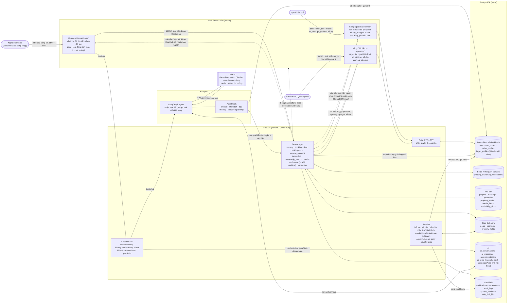
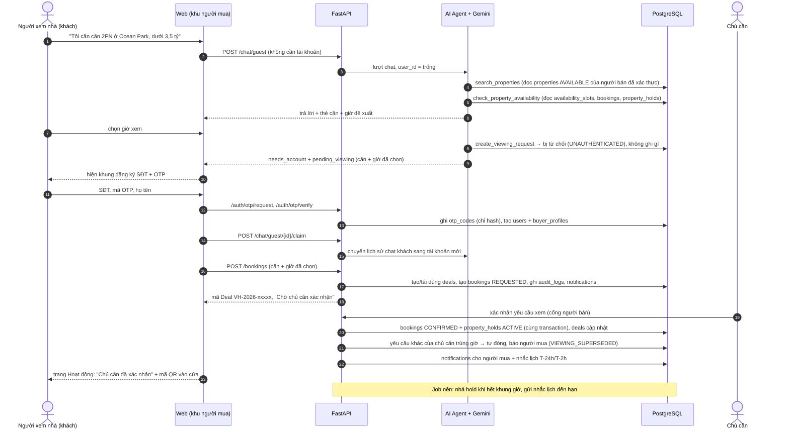

# Data Flow Diagram (Sơ đồ Luồng Dữ liệu)

> Dữ liệu đi qua hệ thống **BookingBot AI Agent** như thế nào, theo đúng code hiện tại:
> ai gửi gì, đi qua lớp nào, được ghi vào bảng nào và ai được đọc lại. Database PostgreSQL là nguồn sự thật;
> AI Agent không truy cập DB trực tiếp mà luôn đi qua Tool Layer → Service Layer.

---

## 1. Tổng quan luồng dữ liệu (Level 1)



**Đọc sơ đồ:** người mua chỉ nói chuyện với AI Agent; mọi thao tác của agent (tìm căn, khớp lịch, đặt lịch)
đều đi qua cùng Service layer với web, nên cùng kiểm tra quyền và quy tắc nghiệp vụ. Chủ căn thấy tên người mua
nhưng không bao giờ nhận số điện thoại hay email (privacy Level 1).

---

## 2. Giải thích các thành phần

### 2.1. Tác nhân (hình bo tròn)

| Thành phần | Là ai | Đưa vào hệ thống | Nhận lại |
|---|---|---|---|
| **Người xem nhà** | Khách mua. Có thể chat ngay với tư cách khách (chưa có tài khoản); chỉ khi gửi yêu cầu xem nhà mới phải đăng ký. Chỉ đăng nhập bằng SĐT + OTP (không email, không mật khẩu) | Nhu cầu bằng lời, lựa chọn căn/giờ, SĐT + OTP | Căn phù hợp, giờ đề xuất, mã Deal, trạng thái + lịch sử lịch xem (trang Hoạt động), mã QR vào cửa, tin nhắn chủ động của agent |
| **Người bán nhà** | Chủ căn muốn bán. Chỉ đăng nhập bằng SĐT + OTP. Xác thực sổ đỏ thành công là tài khoản được xác thực luôn | Tên người đứng tên + mã sổ đỏ + OTP (hoặc yêu cầu hỗ trợ kèm giấy tờ), giá, ảnh, lịch trống, xác nhận/từ chối yêu cầu xem | Yêu cầu xem có tên người mua + khoảng ngân sách (không có SĐT/email); kết quả duyệt tin + lý do từ chối |
| **Chủ đầu tư / Quản trị viên** | Lớp tin cậy (Trust Layer): duyệt tin đăng, xử lý ngoại lệ (kể cả các ca xác thực sổ đỏ người bán không tự làm được). Không duyệt người bán, không duyệt từng lịch xem. Đăng nhập bằng email + mật khẩu ở trang riêng `/operator/login` | Duyệt / từ chối tin kèm lý do; mở khóa sổ, cập nhật SĐT chủ sở hữu, xác thực thủ công, thu hồi xác thực | Tin chờ duyệt, toàn bộ lịch xem, hàng ngoại lệ, giấy tờ người bán gửi |

### 2.2. Giao diện web (React + Vite, deploy trên Vercel)

- **Khu người mua `/buyer/*`**: trang chọn người mới / đã có tài khoản → khung chat với AI Agent (chi tiết căn, ảnh,
  chọn giờ xem, đổi giờ). Bên phải là danh sách căn phù hợp. Trạng thái lịch xem **không nằm trong chat** (sẽ trôi và
  mất khi bắt đầu cuộc trò chuyện mới) mà ở trang **"Hoạt động" `/buyer/activity`**: yêu cầu đang chờ chủ căn (theo dõi
  trạng thái), lịch sắp tới (mã QR vào cửa), và dòng thời gian sự kiện đọc từ `audit_logs` (chủ căn xác nhận / từ chối,
  đổi giờ, hủy…). Chuông thông báo dẫn về trang này. Link cũ `/buyer/bookings` chuyển về trang Hoạt động.
  Trang công khai `/pass/:token` để bảo vệ / lễ tân quét mã QR (hợp lệ từ 60 phút trước tới 30 phút sau giờ xem).
- **Cổng người bán `/owner/*`**:
  - **Xác thực sổ đỏ**: họ tên + mã số sổ khớp dữ liệu Chủ đầu tư, rồi OTP tới SĐT chủ sở hữu → sổ và tài khoản
    được xác thực ngay. Không tự làm được (không nhận OTP, sổ bị khóa, sai lệch dữ liệu, bán thay, đồng sở hữu,
    thừa kế, chưa có sổ, sổ bị người khác nhận) → gửi **yêu cầu hỗ trợ** kèm ảnh giấy tờ (riêng tư).
  - **Căn của tôi**: "Đăng tin bán" (chọn sổ đỏ → thông tin căn tự điền và khóa, người bán chỉ nhập giá, view,
    nội thất, mô tả, ảnh tải từ máy) gửi duyệt ngay, không có bản nháp. Tab "Căn đang yêu cầu duyệt" cho sửa tin
    ngay trong thẻ (tin bị từ chối hiện lý do). "Tạm ngừng" / "Đánh dấu đã bán" (hỏi xác nhận, đã bán là không
    hoàn tác).
  - **Yêu cầu xem**: xác nhận hoặc từ chối (bước "Owner xác nhận" bắt buộc — agent không làm thay được); có dòng
    nhắc khi yêu cầu trùng giờ với yêu cầu khác của chủ căn.
- **Bảng Chủ đầu tư `/operator/*`** (đăng nhập tại `/operator/login`): **Duyệt tin** (ảnh, giá, mô tả; từ chối kèm
  lý do gợi ý), **Ngoại lệ** (lịch xem quá hạn, AI chuyển, hỗ trợ xác thực sổ đỏ với các thao tác mở khóa sổ, cập
  nhật SĐT, xác thực thủ công, thu hồi), **Giám sát lịch xem**.

Mỗi khu (người mua / người bán / Chủ đầu tư) giữ phiên đăng nhập và bộ nhớ dữ liệu riêng trong trình duyệt, nên
có thể đăng nhập người bán và Chủ đầu tư ở hai tab cùng lúc.

Web chỉ gọi REST API (`openapi-fetch`, kiểu dữ liệu sinh từ OpenAPI của backend); không có logic nghiệp vụ
nào chỉ nằm ở web.

### 2.3. Backend FastAPI (deploy trên Render)

- **Auth: OTP / JWT** (`src/services/auth_service.py`, `otp_service.py`, `firebase_auth.py`): `OTP_PROVIDER=local`
  tự sinh mã (không gửi SMS) hoặc `firebase` (Firebase Phone Auth gửi SMS, backend xác minh ID token); SĐT demo
  luôn dùng mã `123456`. Chế độ local: gửi và kiểm tra OTP (chỉ lưu hash,
  hết hạn 5 phút, sai 5 lần thì hủy; tối đa 5 mã **chưa dùng** mỗi 15 phút), cấp JWT, phân quyền theo vai trò
  Người mua / Người bán / Chủ đầu tư. Người mua và người bán chỉ dùng SĐT + OTP; chỉ Chủ đầu tư có mật khẩu.
  Đăng ký phân biệt với đăng nhập: SĐT đã có tài khoản thì không cho đăng ký lại. Chỉ nhận số di động VN 10 số.
- **Chat service** (`src/api/routers/chat.py`, `chat_service.py`): nhận tin nhắn của web và chuyển cho agent
  (bản `/stream` trả SSE). Trước đó: kill switch của dev (`assistant_control`, tắt → 503 `AI_DISABLED`), rate limit
  theo tài khoản / IP khách (`rate_limit_hits`, 429 `RATE_LIMITED`) và guardrails đầu vào; câu trả lời qua guardrails
  đầu ra trước khi hiện (xem [`Agent Flow Diagram.md`](Agent%20Flow%20Diagram.md)). Mỗi lượt ghi trace `ai_turns`.
  `/chat/guest` cho khách chưa có tài khoản; `/claim` chuyển lịch sử chat khách sang tài khoản vừa tạo;
  `/chat` lưu lượt chat của người đã đăng nhập vào `ai_conversations` / `ai_messages`.
- **Service layer** (`src/services/*_service.py`): nơi duy nhất ghi dữ liệu nghiệp vụ. Cả web lẫn agent đều đi
  qua đây, nên cùng một bộ kiểm tra: đúng quyền, căn `AVAILABLE`, người bán `VERIFIED`, Deal chưa đóng, đúng
  trạng thái, đúng khung giờ. Thao tác Deal + Booking + Hold chạy trong một transaction, có khóa dòng và
  ràng buộc chống trùng giờ của PostgreSQL; mọi thao tác quan trọng ghi `audit_logs` và tạo `notifications`.
  - `property` tìm căn (lọc cứng bằng SQL + chấm điểm), đăng tin (thông tin căn lấy từ sổ đỏ, gửi duyệt ngay), duyệt tin,
    Operator gỡ tin đang bán (→ `REJECTED` kèm lý do), đánh dấu đã bán (đóng lịch chưa tới giờ, hỏi bán cho ai).
  - `booking` đặt / đổi giờ / hủy / xác nhận. **Quy tắc trùng giờ theo chủ căn**: yêu cầu chưa xác nhận được trùng
    giờ (chủ căn chọn tiếp ai); một chủ căn không bao giờ có 2 lịch đã xác nhận trùng giờ, kể cả ở 2 căn khác nhau
    (ràng buộc `ex_bookings_owner_no_overlap`). Khi chủ căn xác nhận một lịch, các yêu cầu khác của chủ đó bị trùng
    giờ tự đóng và agent nhắn người mua kèm giờ khác (`VIEWING_SUPERSEDED`). Từ chối có thể đề xuất tối đa 3 giờ khác;
    tới giờ xem mà chủ căn chưa trả lời → `EXPIRED`. Lịch sử hoạt động của người mua (`/bookings/activity`) đọc từ `audit_logs`.
  - `deal` tạo mã `VH-yyyy-xxxxx` và cập nhật trạng thái Deal, `hold` giữ căn cho buổi xem sau khi chủ căn xác nhận,
    `pass` cấp và kiểm tra mã QR vào cửa.
  - `viewing_outcome` sau giờ xem: chủ căn ghi "Đã xem xong" / "Khách không đến" (quên thì được nhắc, quá 48h tự đóng
    `UNREPORTED`); người mua cho biết Quan tâm / Chưa phù hợp; người mua không đồng ý kết quả → ca `VIEWING_DISPUTE`
    cho Chủ đầu tư gọi hai bên và ghi kết quả.
  - `ownership` đối chiếu sổ đỏ + OTP (thành công → người bán `VERIFIED`), `ownership_support` các ca người bán không
    tự xác thực được (mở khóa, cập nhật SĐT, xác thực thủ công, thu hồi), `media` ảnh tải từ máy (lưu trong DB,
    giấy tờ hỗ trợ là riêng tư), `seller` trạng thái người bán, `notification` thông báo trong web,
    `escalation` hàng ngoại lệ cho người thật.
- **Job nền** (`src/jobs.py`, chạy trong cùng tiến trình API, mặc định mỗi 60 giây):
  nhả giữ căn khi hết khung giờ xem; gửi nhắc lịch T-24h / T-2h (agent viết lại lời nhắc cho từng khách);
  đóng `EXPIRED` các yêu cầu tới giờ xem chưa được trả lời; chuyển cho người thật các yêu cầu quá hạn `respond_by`
  và tự đóng ca đã được xử lý; nhắc chủ căn ghi nhận sau buổi xem, quá 48h → `UNREPORTED`; agent follow-up — gợi ý
  giờ hoặc căn khác khi yêu cầu bị từ chối / chưa được trả lời; dọn trace và bộ đếm rate limit cũ; giữ lịch trống
  demo 14 ngày tới (chỉ khi `SEED_DEMO_DATA`).

### 2.4. AI Agent

- **LangGraph agent** (`src/agents/graph.py`, `prompts.py`): nhận mục tiêu của khách ("đặt giúp tôi chiều mai")
  và tự gọi tool nhiều bước cho tới khi xong hoặc cần hỏi lại. Prompt có sẵn lịch ngày tháng (tránh đặt nhầm ngày)
  và tiêu chí khách đã nói ở các lần trước (`buyer_memory`). Bộ nhớ hội thoại lưu trong PostgreSQL qua checkpoint
  của LangGraph, khởi động lại server không mất.
- **Agent tools** (`src/agents/tools.py` → `src/services/agent_api.py`): 12 tool — `list_projects`,
  `search_properties`, `get_property_detail`, `get_seller_status`, `check_seller_availability`,
  `check_property_availability`, `get_deal_status`, `get_booking_status`, `create_viewing_request`,
  `cancel_viewing`, `reschedule_viewing`, `create_human_escalation`. Tool chỉ gọi Service layer với đúng
  quyền của khách đang chat; không có tool xác nhận lịch hay tạo giữ căn (việc của chủ căn), không có tool đọc
  SĐT/email. Khách chưa đăng nhập mà muốn đặt lịch → tool trả lỗi, web hiện khung đăng ký và gửi tiếp yêu cầu.
- **LLM** (`src/services/llm.py`): chọn bằng `LLM_PROVIDER` — `openai` (mặc định `gpt-4o-mini`), `google` (bản Render:
  `gemini-flash-lite-latest`, dự phòng `gemini-flash-latest`), `anthropic` (mặc định `claude-opus-5-5`; bản Cloud Run:
  `claude-sonnet-5-5`, dự phòng OpenRouter `google/gemini-3.8-flash` qua `LLM_FALLBACK_PROVIDER`), `openrouter`, `groq`.
  LLM chỉ nhận prompt + lịch sử và trả lời hoặc yêu cầu gọi tool; nó không bao giờ chạm DB.
  Lỗi LLM → khách thấy thông báo gián đoạn, không có hành động nào được ghi.
- **Guardrails** (`src/agents/guardrails.py`, `guardrail_judge.py`): che PII khách gõ và trong câu trả lời, chặn prompt
  injection (không gọi model), thay câu trả lời nói lịch "đã xác nhận" khi chưa có, nhắc mã căn không có thật, hướng dẫn
  đặt cọc / đàm phán / dự đoán giá / cam kết pháp lý; giám khảo AI model nhỏ chỉ gọi khi có dấu hiệu rủi ro.

### 2.5. Kho dữ liệu (PostgreSQL, deploy trên Neon)

| Nhóm | Bảng | Dùng để |
|---|---|---|
| **Danh tính + trí nhớ khách** | `users`, `otp_codes`, `seller_profiles`, `buyer_profiles` | Tài khoản, mã OTP, trạng thái xác thực người bán, tiêu chí + giờ rảnh khách đã nói (để agent nhớ ở lần chat sau) |
| **Sổ đỏ** | `property_ownership_verifications` | Dữ liệu sổ đỏ của Chủ đầu tư (người đứng tên, mã sổ, SĐT chủ sở hữu) kèm thông tin căn gốc (tòa, mã căn, diện tích, số phòng, tầng, hướng) mà tin đăng lấy theo |
| **Kho căn** | `projects`, `buildings`, `properties`, `property_media`, `media_files`, `availability_slots` | Căn đang bán, ảnh (ảnh tải từ máy lưu trong `media_files`), lịch trống của chủ căn |
| **Giao dịch xem** | `deals`, `bookings`, `property_holds` | Mỗi cặp Người mua + Căn có một Deal; lịch xem và trạng thái; giữ căn trong khung giờ xem đã xác nhận |
| **AI** | `ai_conversations`, `ai_messages`, `recommendations`, `ai_turns`, `checkpoint*` | Lịch sử chat, căn đã gợi ý, trace từng lượt chat cho dev, bộ nhớ hội thoại của agent |
| **Vận hành** | `notifications`, `escalations`, `audit_logs`, `system_settings`, `rate_limit_hits` | Thông báo trong web, hàng ngoại lệ cho người thật, nhật ký truy vết, công tắc vận hành (kill switch, phiên bản seed), bộ đếm rate limit |

Chi tiết ai ghi / ai đọc từng bảng ở mục 5.

### 2.6. Ý nghĩa các mũi tên

- **Mũi tên liền**: dữ liệu được gửi vào để xử lý hoặc ghi (yêu cầu, lệnh gọi tool, ghi DB). `<-->` là vừa đọc vừa ghi.
- **Mũi tên đứt**: dữ liệu trả về cho web hiển thị. Đáng chú ý là chiều về Cổng người bán chỉ mang họ tên người mua
  + khoảng ngân sách + nhu cầu, không bao giờ có SĐT/email (bảo vệ thông tin cá nhân, AC-03).

---

## 3. Luồng chính: người mới chat → đặt lịch → chủ căn xác nhận



---

## 4. Luồng người bán: xác thực sổ đỏ → đăng tin → Chủ đầu tư duyệt tin

```mermaid
sequenceDiagram
    autonumber
    actor S as Người bán
    participant W as Web (cổng người bán)
    participant API as FastAPI
    participant DB as PostgreSQL
    actor O as Chủ đầu tư

    S->>W: SĐT + OTP (không có mật khẩu)
    W->>API: /auth/otp/request, /auth/otp/verify (role OWNER)
    API->>DB: users + seller_profiles (UNVERIFIED)
    S->>W: họ tên người đứng tên + mã số sổ đỏ
    W->>API: POST /owner/ownership/claim
    API->>DB: đối chiếu property_ownership_verifications
    Note over API,DB: SĐT đăng nhập phải trùng SĐT chủ sở hữu trên sổ (khác → NOT_OWNER_PHONE);<br/>sai tên/mã sổ tối đa 5 lần/giờ; sổ đã có người nhận → UNIT_CLAIMED
    API->>DB: otp_codes (gửi tới owner_phone ghi trên sổ), sổ → OTP_SENT
    S->>W: nhập OTP
    W->>API: POST /owner/ownership/{id}/confirm
    API->>DB: sổ → VERIFIED, gắn user_id, seller_profiles → VERIFIED, ghi audit_logs
    Note over API,DB: Sai OTP 5 lần → sổ FAILED (khóa) → người bán gửi yêu cầu hỗ trợ (mục 4.1)
    S->>W: "Đăng tin bán": chọn sổ đỏ (thông tin căn tự điền), giá, view, nội thất, ảnh từ máy
    W->>API: POST /owner/media (từng ảnh, lưu media_files)
    W->>API: POST /owner/properties (verification_id, photos)
    API->>DB: properties PENDING_REVIEW ngay (thông tin căn lấy từ sổ đỏ; mỗi sổ một tin)
    O->>API: duyệt tin, hoặc từ chối kèm lý do
    API->>DB: properties AVAILABLE / REJECTED + rejection_reason, notifications
    Note over S,W: Bị từ chối: sửa ngay trong tab "Căn đang yêu cầu duyệt" → lưu là gửi duyệt lại
    Note over API,DB: Chỉ căn AVAILABLE của người bán VERIFIED mới được AI gợi ý và nhận đặt lịch
```

### 4.1. Khi người bán không tự xác thực được

```mermaid
sequenceDiagram
    autonumber
    actor S as Người bán
    participant API as FastAPI
    participant DB as PostgreSQL
    actor O as Chủ đầu tư

    S->>API: POST /owner/media (private) — ảnh CCCD, giấy ủy quyền, hợp đồng…
    S->>API: POST /owner/ownership/support (lý do, mã sổ, mô tả, giấy tờ)
    API->>DB: escalations OWNERSHIP_SUPPORT (OPEN), notifications cho Chủ đầu tư
    O->>API: GET /operator/escalations/{id}/ownership (yêu cầu + giấy tờ + sổ đỏ hiện tại)
    alt Không nhận OTP / sổ bị khóa
        O->>API: .../ownership/unlock (kèm SĐT mới nếu có)
        API->>DB: sổ → UNVERIFIED, otp_attempts = 0, owner_phone mới; ca RESOLVED
        Note over S: Người bán làm lại bước OTP như bình thường
    else Bán thay / đồng sở hữu / thừa kế / chưa có sổ / dữ liệu sai
        O->>API: .../ownership/verify (ghi rõ đã kiểm tra gì)
        API->>DB: sổ → VERIFIED cho người bán (thêm sổ nếu chưa có), seller_profiles VERIFIED; ca RESOLVED
    else Sổ bị người khác nhận sai
        O->>API: .../ownership/revoke (lý do)
        API->>DB: hủy lịch xem chưa tới giờ của căn (một transaction), gỡ tin (WITHDRAWN), sổ → UNVERIFIED, báo người đang giữ sổ
        O->>API: .../ownership/verify cho chủ thật
    end
    API->>DB: audit_logs cho mọi thao tác, notifications cho người bán
```

---

## 5. Kho dữ liệu: ai ghi, ai đọc

| Kho (bảng) | Ghi bởi | Đọc bởi | Ghi chú |
|---|---|---|---|
| `users`, `otp_codes` | Auth (đăng nhập/đăng ký OTP) | Auth, mọi API cần đăng nhập | OTP chỉ lưu hash, hết hạn 5 phút, sai 5 lần thì hủy |
| `buyer_profiles` | Auth khi tạo người mua; agent ghi tiêu chí + giờ rảnh khi tìm căn / khớp lịch | Booking (chủ căn chỉ thấy ngân sách); prompt của agent ở các cuộc chat sau; job follow-up | Không chứa SĐT/email |
| `seller_profiles` | Auth; xác thực sổ đỏ thành công (→ VERIFIED); Chủ đầu tư khi xử lý hỗ trợ / thu hồi | Duyệt tin, tìm căn, đặt lịch | Chỉ người bán VERIFIED mới có căn được gợi ý / đặt lịch |
| `property_ownership_verifications` | Seed từ dữ liệu Chủ đầu tư (kèm thông tin căn); xác thực sổ đỏ; Chủ đầu tư (mở khóa, đổi SĐT, xác thực thủ công, thu hồi) | Xác thực sổ đỏ, đăng tin (lấy thông tin căn), Chủ đầu tư | Mỗi sổ gắn đúng một tin (`properties.verification_id`) |
| `properties`, `property_media` | Người bán (thông tin căn theo sổ đỏ, giá, ảnh; tạm ngừng; đánh dấu đã bán); Chủ đầu tư duyệt / từ chối / gỡ tin | Agent (tìm căn), web | Không có bản nháp: đăng là vào hàng chờ duyệt |
| `media_files` | Người bán tải ảnh căn / giấy tờ hỗ trợ | Web (ảnh căn công khai); giấy tờ riêng tư chỉ người gửi và Chủ đầu tư | Lưu trong DB để không mất khi server khởi động lại; sau này có thể chuyển S3 |
| `availability_slots` | Người bán (lịch trống); chủ căn từ chối kèm đóng khung giờ | Khớp lịch | Job hằng ngày giữ lịch demo 14 ngày tới |
| `deals`, `bookings` | Đặt lịch (web hoặc agent), chủ căn xác nhận/từ chối/ghi nhận kết quả, người mua phản hồi sau buổi xem, job nền (`EXPIRED`, `UNREPORTED`), Chủ đầu tư (hủy lịch kèm lý do, ghi kết quả tranh chấp, hủy khi thu hồi sổ) | Người mua, chủ căn, Chủ đầu tư | Ràng buộc DB theo chủ căn: không 2 lịch đã xác nhận trùng giờ; yêu cầu chưa xác nhận được trùng |
| `property_holds` | Khi chủ căn xác nhận; job nền nhả hold | Khớp lịch | Giữ căn cho buổi xem, không phải giữ để mua |
| `ai_conversations`, `ai_messages`, `recommendations` | Chat service (người đã đăng nhập) | Lịch sử chat; Operator xem đoạn chat gần nhất của ca AI chuyển | |
| `ai_turns` | Chat service (mọi lượt, cả khách và lượt lỗi) | Dev (`scripts/ai_traces.py`, dashboard `/dev`) | Không hiển thị cho người dùng; tự xóa sau `AI_TRACE_RETENTION_DAYS` |
| `system_settings`, `rate_limit_hits` | Dev (kill switch), seed (`seed.version`); chat API (đếm tin nhắn) | Mọi instance | Job nền dọn bộ đếm sau 25h |
| `checkpoints`, `checkpoint_*` | LangGraph (bộ nhớ hội thoại, cả chat khách) | Agent mỗi lượt chat | Bảng do LangGraph tự tạo/migrate, Alembic bỏ qua |
| `notifications` | Booking, sổ đỏ, duyệt tin, hỗ trợ xác thực, job nhắc lịch, agent (`AGENT_FOLLOWUP`, `AGENT_NEW_MATCH`, `VIEWING_SUPERSEDED`, `PROPERTY_SOLD` — hiện trong chat) | Chuông thông báo + bong bóng realtime (SSE `/notifications/stream`) cho cả 3 vai trò | Chưa có SMS/Zalo; mỗi gợi ý của agent gửi một lần (`dedupe_key`) |
| `escalations` | Agent (`create_human_escalation`), job (chủ căn quá hạn trả lời), người bán (`OWNERSHIP_SUPPORT`), người mua không đồng ý kết quả buổi xem (`VIEWING_DISPUTE`) | Chủ đầu tư (hàng ngoại lệ), người gửi (kết quả) | Khi không có giờ chung, khách muốn gặp người thật, người bán không tự xác thực sổ đỏ được… |
| `audit_logs` | Mọi hành động quan trọng | Kiểm tra, truy vết; trang Hoạt động của người mua (sự kiện lịch xem) | |

**Bộ nhớ hội thoại** nằm trong PostgreSQL (`AGENT_MEMORY=postgres`), khởi động lại server không mất ngữ cảnh.
Nếu không kết nối được (vd. Windows chạy uvicorn không có `--reload`), server dùng RAM và ghi cảnh báo.
