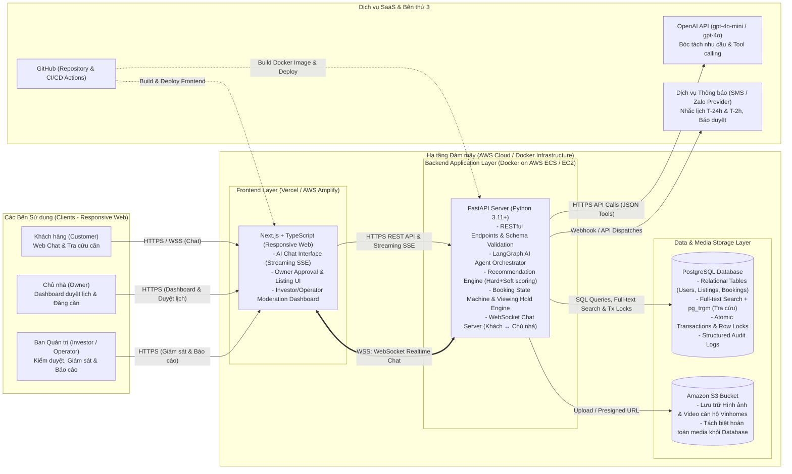

# Deployment Diagram (Sơ đồ Triển khai Hạ tầng)

> Sơ đồ kiến trúc triển khai hệ thống **BookingBot AI Agent** theo đặc tả kỹ thuật tại **§10 của [spec_updated.md](file:///Users/macos/AI%20Th%E1%BB%B1c%20Chi%E1%BA%BFn/P001-Discovery/P-001/.specify/spec_updated.md)** (Docker + AWS, Next.js, FastAPI, PostgreSQL với Full-text search, S3 Media, WebSocket Realtime Chat, OpenAI API).

