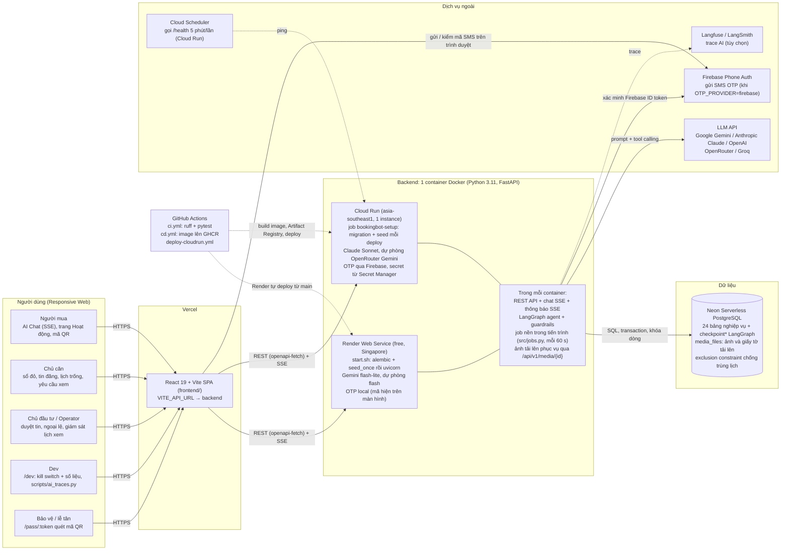

# Deployment Diagram (Sơ đồ Triển khai Hạ tầng)

> Hạ tầng đang chạy của **BookingBot AI Agent**: frontend SPA trên Vercel, backend Docker trên **Render**
> ([`render.yaml`](../render.yaml)) hoặc **Google Cloud Run** ([`.github/workflows/deploy-cloudrun.yml`](../.github/workflows/deploy-cloudrun.yml)),
> cả hai dùng chung Dockerfile và một database Neon Postgres. Hướng dẫn: mục 8 của [`README.md`](../README.md).

## Ghi chú

- **Một instance backend**: hold hết hạn, nhắc lịch, hết hạn yêu cầu, escalation, follow-up chạy trong tiến trình
  API (`src/jobs.py`), nên Cloud Run đặt `--max-instances=1`. Thông báo realtime (`GET /notifications/stream`) đọc
  bảng `notifications` theo chu kỳ nên vẫn đúng nếu sau này chạy nhiều instance; luồng SSE tự đóng sau 240 s (dưới
  timeout Cloud Run) và web tự nối lại.
- **Media**: ảnh người bán tải lên và giấy tờ hỗ trợ xác thực lưu trong PostgreSQL (`media_files`), giấy tờ là
  riêng tư (chỉ người gửi và Operator xem). Amazon S3 là đích dài hạn, chưa dùng.
- **Chưa có**: gửi SMS/Zalo cho thông báo (chỉ in-app + bong bóng realtime), WebSocket chat Người mua ↔ Chủ căn
  (post-MVP), Vector DB.
- **Seed demo**: chỉ chạy một lần mỗi DB (`src/db/seed_once.py`, `SEED_VERSION`); `SEED_DEMO_DATA=false` cho DB thật.
