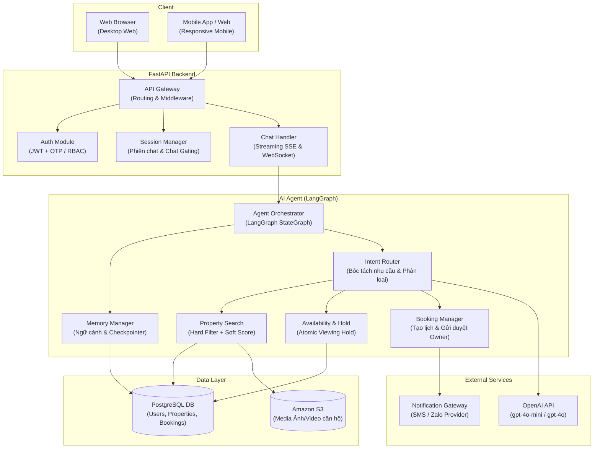

# Sơ đồ Kiến trúc Tổng thể (System Overview Diagram)

> Sơ đồ kiến trúc tổng thể của hệ thống **BookingBot AI Agent** được thiết kế theo cấu trúc phân tầng trực quan, tinh gọn giúp người đọc hiểu ngay toàn bộ hệ thống gồm những gì (Client $\rightarrow$ FastAPI Backend $\rightarrow$ AI Agent LangGraph $\rightarrow$ Data Layer & External Services).

---

## Bóc tách vai trò các khối chức năng theo `spec_updated.md`

| Phân tầng (Layer) | Khối thành phần | Chức năng kỹ thuật chi tiết |
|---|---|---|
| **Client** | **Web Browser / Mobile App** | Giao diện Web Responsive hỗ trợ cả Desktop và Mobile: Khách hàng tìm căn & chat AI; Chủ nhà (Owner) quản lý tin & duyệt lịch; Ban quản trị (Operator) kiểm duyệt. |
| **FastAPI Backend** | **API Gateway** | Cổng tiếp nhận request tập trung, điều hướng RESTful endpoints và kiểm soát Pydantic validation. |
| | **Auth Module** | Quản lý định danh: Khách hàng xác thực qua OTP/mã booking; Chủ nhà và Operator đăng nhập qua JWT + Argon2id/bcrypt. |
| | **Session Manager** | Duy trì trạng thái phiên người dùng và quản lý **Chat Gating** (chỉ mở kênh chat trực tiếp sau khi xem nhà thành công và có Purchase Request). |
| | **Chat Handler** | Xử lý streaming Server-Sent Events (SSE) cho hội thoại AI và WebSocket server phục vụ nhắn tin thời gian thực 1-1 Khách ↔ Chủ nhà. |
| **AI Agent (LangGraph)** | **Agent Orchestrator** | Quản lý đồ thị trạng thái (StateGraph), điều phối luồng xử lý và đảm bảo AI tuân thủ đúng ranh giới an toàn. |
| | **Memory Manager** | Lưu trữ ngữ cảnh hội thoại đa lượt (Multi-turn state), ghi nhớ tiêu chí đã bóc tách qua LangGraph Checkpointer. |
| | **Intent Router** | Phân loại ý định từ câu chat tự nhiên, trích xuất cấu trúc `CustomerPreference` và điều hướng chọn Tool phù hợp. |
| | **Controlled Tools** | • **Property Search:** Lọc SQL + tính điểm soft scoring. • **Availability & Hold:** Kiểm tra lịch trống và kích hoạt Viewing Hold nguyên tử. • **Booking Manager:** Tạo yêu cầu đặt lịch và kích hoạt luồng Owner Approval. |
| **Data Layer** | **PostgreSQL DB** | Lưu trữ dữ liệu quan hệ (Properties, Bookings, Holds, Audit Logs); Full-text search + `pg_trgm`; ACID transaction và Row-level lock. |
| | **Amazon S3** | Lưu trữ độc lập toàn bộ hình ảnh và video căn hộ Vinhomes, tách biệt hoàn toàn khỏi Database. |
| **External Services** | **OpenAI API** | Cung cấp mô hình ngôn ngữ lớn (mặc định `gpt-4o-mini`) phục vụ bóc tách nhu cầu và suy luận. |
| | **Notification Gateway** | Dịch vụ gửi thông báo đẩy (In-app, SMS/Zalo) để nhắc lịch hẹn tự động trước **T-24h** và **T-2h**. |