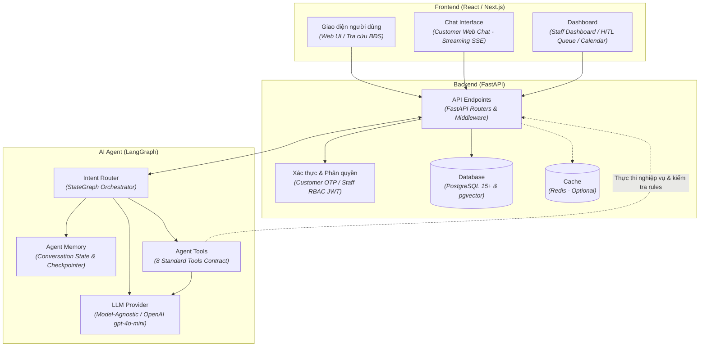

# Sơ đồ Kiến trúc Tổng thể (System Overview Diagram)

> Sơ đồ dưới đây minh họa kiến trúc tổng thể của hệ thống **BookingBot AI Agent** theo đúng cấu trúc phân tầng (Frontend, Backend, AI Agent) và nội dung đặc tả kỹ thuật từ [spec.md](file:///Users/macos/AI%20Th%E1%BB%B1c%20Chi%E1%BA%BFn/P001-Discovery/P-001/.specify/spec.md).

---

## Bóc tách chi tiết thành phần theo `spec.md`

| Phân tầng | Thành phần trong sơ đồ | Vai trò & Đặc tả từ `spec.md` |
|---|---|---|
| **Frontend (React / Next.js)** | **Giao diện người dùng** | Cung cấp giao diện duyệt, tìm kiếm căn hộ Vinhomes, thông tin tiện ích và chính sách dự án. |
| | **Chat Interface** | Giao diện hội thoại tự nhiên với khách hàng qua Web Chat; hỗ trợ **streaming (SSE)** hiển thị câu trả lời tức thì, nhận diện context và thẻ căn hộ (Property Cards). |
| | **Dashboard** | Bảng điều khiển tác nghiệp của Sale / Operator: Calendar lịch trống 4 tài nguyên, danh sách duyệt yêu cầu (**HITL Queue**), cấu hình thời gian soft-hold. |
| **Backend (FastAPI)** | **API Endpoints** | Cổng giao tiếp RESTful API; đóng vai trò **Gatekeeper** xác thực schema Pydantic, điều phối luồng và kiểm soát giao dịch. |
| | **Xác thực & Phân quyền** | Quản lý định danh: Khách hàng xác thực không cần login (qua Booking Code / SMS OTP); Sale & Operator đăng nhập phân quyền RBAC (Data Isolation theo dự án). |
| | **Database** | **PostgreSQL 15+**: Lưu trữ dữ liệu quan hệ (Properties, Sales, Bookings, Audit Logs, AI Runs); **pgvector**: Lưu trữ embedding phục vụ tra cứu RAG FAQ tri thức tĩnh. Áp dụng **Row-level locking (`SELECT ... FOR UPDATE`)** chống double-booking. |
| | **Cache** | **Redis (Optional)**: Cache tạm thời cho session và hỗ trợ distributed lock khi scale. |
| **AI Agent (LangGraph)** | **Intent Router** | **Orchestrator v2**: Phân loại intent từ câu chat của khách, duy trì đồ thị trạng thái hội thoại, kiểm tra thông tin còn thiếu (Missing Entities). |
| | **Agent Memory** | Lưu trữ ngữ cảnh đa lượt (Multi-turn state), lưu các tiêu chí đã bóc tách (`extracted_criteria`) và lịch sử qua Checkpointer của LangGraph. |
| | **Agent Tools** | Tập hợp **8 Tools chuẩn theo Patch v2**: `search_property`, `get_property_detail`, `check_availability`, `create_soft_hold`, `request_sale_approval`, `reschedule_booking`, `cancel_booking`, `send_notification` (+ RAG `search_knowledge`). |
| | **LLM Provider** | Lớp Adapter độc lập mô hình: Mặc định sử dụng **OpenAI `gpt-4o-mini`** (hoặc `gpt-4o`), có thể hoán đổi sang Claude / Gemini mà không ảnh hưởng logic lõi. |