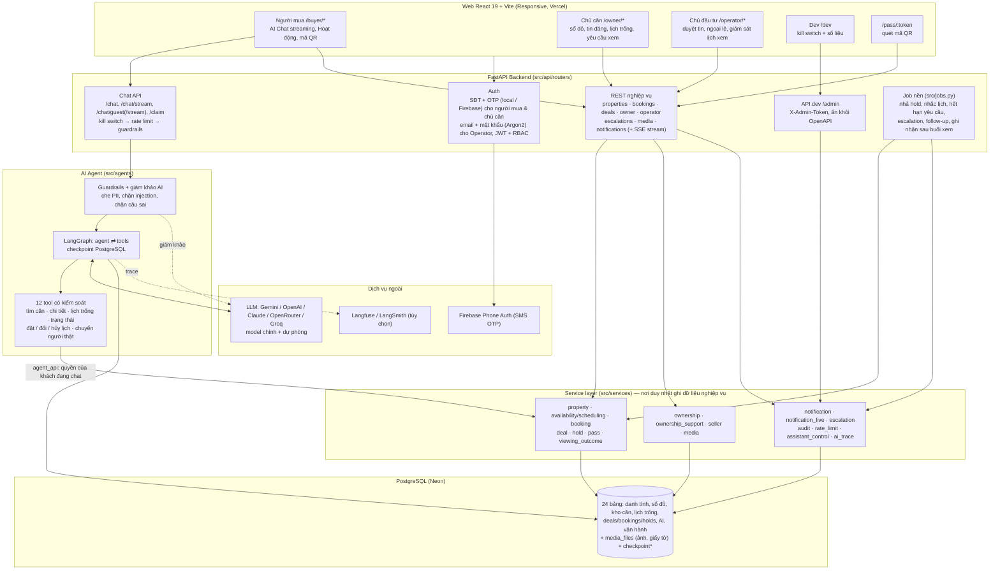

# Sơ đồ Kiến trúc Tổng thể (System Overview Diagram)

> Hệ thống **BookingBot AI Agent** gồm những gì, theo code hiện tại: Web (React) → FastAPI (router → service)
> → AI Agent (LangGraph) → PostgreSQL và dịch vụ ngoài. Chi tiết luồng dữ liệu: [`Data Flow Diagram.md`](Data%20Flow%20Diagram.md);
> quy tắc nghiệp vụ: [`CLAUDE.md`](../CLAUDE.md).

---

## Vai trò các khối

| Phân tầng | Khối | Chức năng |
|---|---|---|
| **Client** | **Web React + Vite** | Một SPA responsive cho 3 vai trò + trang dev + trang quét mã QR. Chỉ gọi REST/SSE (`openapi-fetch`, kiểu sinh từ OpenAPI); không có logic nghiệp vụ nào chỉ nằm ở web. Người mua không có trang tìm kiếm/bộ lọc: vào thẳng AI Chat. |
| **FastAPI Backend** | **Auth** | Người mua và chủ căn chỉ dùng SĐT + OTP (`OTP_PROVIDER=local` hoặc `firebase`; SĐT demo dùng mã cố định `123456`); Operator dùng email + mật khẩu. JWT + RBAC Buyer / Seller / Operator. |
| | **Chat API** | Nhận tin nhắn (cả khách chưa đăng nhập), kiểm tra kill switch và rate limit, chạy agent, stream câu trả lời đã qua guardrails (SSE). `/claim` chuyển chat của khách sang tài khoản mới. |
| | **REST nghiệp vụ** | Tìm căn / giờ xem, đặt / đổi / hủy lịch, trang Hoạt động, mã QR; cổng chủ căn (sổ đỏ, tin đăng, lịch trống, xác nhận / từ chối, ghi nhận sau buổi xem, đánh dấu đã bán); Operator (duyệt / gỡ tin, hủy lịch, ngoại lệ); thông báo + luồng SSE realtime. |
| | **Job nền** | Chạy trong tiến trình API mỗi `JOB_INTERVAL_SECONDS` (60 s). |
| **AI Agent** | **LangGraph** | Đồ thị 2 node `agent` ⇄ `tools`; bộ nhớ hội thoại trong checkpoint PostgreSQL; prompt có lịch ngày tháng và tiêu chí khách đã nói (`buyer_memory`). |
| | **Guardrails** | Lớp code quanh mỗi lượt chat (`guardrails.py`) + giám khảo AI model nhỏ (`guardrail_judge.py`) chỉ gọi khi có dấu hiệu rủi ro. |
| | **12 tool** | Chỉ gọi Service layer với quyền của khách; không có tool xác nhận lịch, tạo hold, gửi thông báo hay đọc SĐT/email. |
| **Service layer** | **Services** | Kiểm tra quyền + business rules, chạy Deal + Booking + Hold trong một transaction có khóa dòng và exclusion constraint, ghi `audit_logs` và `notifications`. |
| **Data** | **PostgreSQL** | Source of truth. Ảnh / giấy tờ tải lên lưu trong `media_files` (S3 là đích dài hạn, chưa dùng). Không dùng Vector DB. |
| **External** | **LLM** | Chọn bằng `LLM_PROVIDER`; model dự phòng có thể ở provider khác (`LLM_FALLBACK_PROVIDER`). LLM không bao giờ chạm DB. |
| | **Firebase** | Gửi / kiểm mã SMS trên trình duyệt; backend chỉ xác minh Firebase ID token. |
| | **Thông báo** | Hiện chỉ in-app (chuông + bong bóng realtime); SMS/Zalo cho thông báo chưa tích hợp. |
