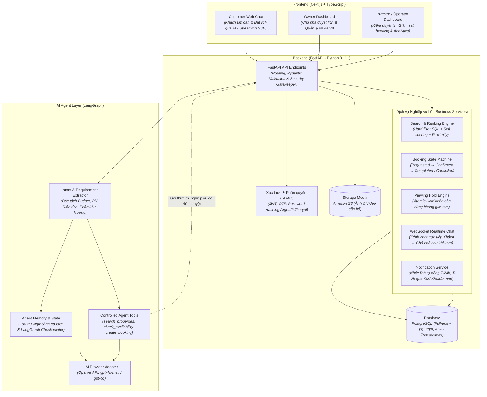

# Sơ đồ Kiến trúc Tổng thể (System Overview Diagram)

> Sơ đồ kiến trúc tổng thể của hệ thống **BookingBot AI Agent** theo cấu trúc phân tầng (Frontend, Backend, AI Agent) và đặc tả kỹ thuật chi tiết tại **§10 của [spec_updated.md](file:///Users/macos/AI%20Th%E1%BB%B1c%20Chi%E1%BA%BFn/P001-Discovery/P-001/.specify/spec_updated.md)**.

---

## Bóc tách chi tiết thành phần theo `spec_updated.md`

| Phân tầng | Thành phần | Đặc tả kỹ thuật theo `spec_updated.md` |
|---|---|---|
| **Frontend (Next.js + TypeScript)** | **Customer Web Chat** | Giao diện AI-first đàm thoại tự nhiên với khách hàng; hỗ trợ streaming SSE, hiển thị Property Cards kèm điểm xếp hạng và lý do gợi ý (Explainability). |
| | **Owner Dashboard** | Giao diện cho Chủ nhà: Quản lý danh sách căn hộ đăng bán/cho thuê, nhận thông báo và phê duyệt/từ chối lịch xem nhà (Owner Approval). |
| | **Operator Dashboard** | Giao diện Ban quản trị / Chủ đầu tư: Duyệt tin đăng (`APPROVED`), theo dõi trạng thái Viewing Hold, xử lý ngoại lệ và xem báo cáo chỉ số (KPIs). |
| **Backend (FastAPI)** | **API Endpoints** | Cổng giao tiếp RESTful API; kiểm soát bảo mật, Pydantic schemas, đóng vai trò **Source of Truth** (tuyệt đối không cho AI ghi đè dữ liệu trực tiếp). |
| | **Auth & RBAC** | Xác thực đa vai trò: Khách hàng qua OTP/Booking Code; Chủ nhà & Ban quản trị đăng nhập JWT + Password Hashing bằng Argon2id/bcrypt. |
| | **Search & Ranking Engine** | Thuật toán xếp hạng lai 5 bước: (1) Hard filter SQL $\rightarrow$ (2) Soft scoring (Giá 30%, DT 20%, PN 20%, Hướng 15%, Tầng 15%) $\rightarrow$ (3) Priority weighting $\rightarrow$ (4) Proximity score $\rightarrow$ (5) Explainability. |
| | **Booking & Hold Engine** | Quản lý vòng đời Booking (`REQUESTED → CONFIRMED → COMPLETED`) và cơ chế **Viewing Hold nguyên tử (Atomic)**: Chỉ khóa căn đúng khung giờ xem sau khi chủ nhà duyệt. |
| | **WebSocket Realtime Chat** | Kênh chat trực tiếp 1-1 giữa Khách hàng và Chủ nhà sau khi buổi xem nhà thành công và có Purchase Request. |
| | **Storage & Database** | **PostgreSQL**: Lưu trữ bảng quan hệ, Full-text Search + `pg_trgm`, ACID transactions; **Amazon S3**: Lưu trữ toàn bộ media hình ảnh, video căn hộ. |
| **AI Agent (LangGraph)** | **Intent Router & Extractor** | Phân loại intent từ câu chat của khách hàng, trích xuất cấu trúc `CustomerPreference`, xác định các tiêu chí còn thiếu để hỏi lại. |
| | **Agent Memory** | Quản lý hội thoại đa lượt (Multi-turn state), ghi nhớ lịch sử tương tác qua cơ chế Checkpointing của LangGraph. |
| | **Controlled Tools** | Bộ công cụ chuẩn hóa: `search_properties`, `get_property_detail`, `check_availability`, `create_booking_request`, `reschedule_booking`, `cancel_booking`. |
| | **LLM Provider** | OpenAI API (`gpt-4o-mini` mặc định, tối ưu chi phí & độ trễ). |