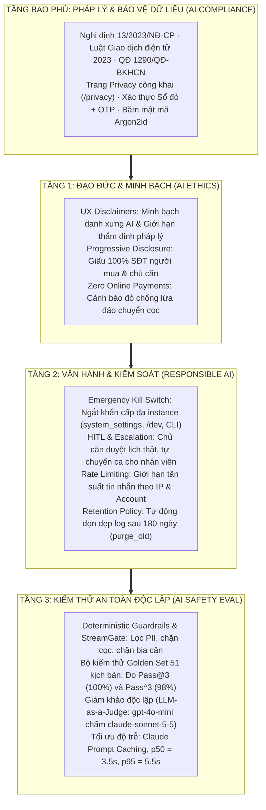

# Báo Cáo Tổng Hợp Quản Trị AI Có Trách Nhiệm (Responsible AI Governance Report)
## Dự án: BookingBot AI Agent — Trợ lý Đặt lịch Xem nhà & Giữ căn Vinhomes
**Đơn vị thực hiện:** Team Tomorrow · AI20K Build Phase (Cohort 4)  
**Thời điểm nghiệm thu:** Tháng 10/2026 (Đồng bộ với commit `737dade` trên GitHub `AI20K-Build-Phase-Cohort-4/P-001`)  
**Khung tham chiếu áp dụng:** Mô hình Quản trị 3 Tầng tiền phát hành (*AI Ethics $\rightarrow$ Responsible AI $\rightarrow$ AI Safety Eval*) kết hợp Tầng bao phủ Tuân thủ Pháp lý (*AI Compliance* theo pháp luật Việt Nam thực định).

---

## 1. Tổng Quan Kiến Trúc Quản Trị

Dự án **BookingBot AI Agent** ứng dụng mô hình ngôn ngữ lớn (LLM) để hỗ trợ người mua nhà tìm kiếm căn hộ, đối soát lịch trống và đặt hẹn xem nhà trực tiếp với chủ căn hộ tại các đại đô thị Vinhomes (Vinhomes Ocean Park, Smart City, Grand Park). 

Vì liên quan trực tiếp đến **giao dịch tài sản giá trị lớn**, **an toàn thể chất ngoài đời thực**, và **quyền riêng tư gia chủ**, hệ thống được thiết kế theo triết lý:
> **"AI-first, không AI-only — Kiểm soát rủi ro ở tầng kiến trúc phần mềm (Software Architecture), không chỉ phụ thuộc vào Prompt."**

---

## 2. Tầng 1: Đạo Đức AI & Minh Bạch Người Dùng (AI Ethics Framework)

### 2.1. Minh bạch danh xưng và tuyên bố trách nhiệm (UX Disclaimers)
- **Minh bạch bản chất AI:** Ngay từ lời chào mở đầu và giao diện, hệ thống định danh rõ là "Trợ lý AI".
- **UX Disclaimer pháp lý dưới khung Chat:** Để ngăn ngừa việc người mua ngộ nhận nhãn *"Căn đã xác thực chủ sở hữu"* là *"Đã thẩm định pháp lý sạch hoàn toàn"* (Rủi ro #6), hệ thống gắn cố định 2 dòng khuyến cáo ngay dưới ô nhập tin nhắn tại [`frontend/src/buyer/BuyerChatPage.tsx:928-934`](file:///Users/macos/AI%20Th%E1%BB%B1c%20Chi%E1%BA%BFn/P001-Discovery/P-001/frontend/src/buyer/BuyerChatPage.tsx#L928-L934):
  > *"Trợ lý chỉ gợi ý căn có trong hệ thống · Số điện thoại của bạn luôn được ẩn với chủ căn"*  
  > *"Trợ lý AI tổng hợp dữ liệu từ CĐT. Vui lòng kiểm tra lại thông tin. 'Căn đã xác thực chủ sở hữu' không thay thế việc thẩm định pháp lý hợp đồng."*

### 2.2. Bảo vệ quyền riêng tư & Tiết lộ tăng dần (Privacy by Design & Progressive Disclosure)
- **Ẩn số điện thoại 2 chiều:**
  - Chủ căn hộ (Owner) khi nhận yêu cầu đặt lịch chỉ thấy: Họ tên viết tắt, mã người mua, khoảng ngân sách, nhu cầu và giờ xem. **Hoàn toàn không thấy số điện thoại hay email của người mua** (AC-03).
  - Người mua không thấy số điện thoại cá nhân của chủ nhà.
- **Thẻ vào cửa QR Code an toàn:** Mã QR vào cửa đại đô thị ([`PassCheckPage.tsx`](file:///Users/macos/AI%20Th%E1%BB%B1c%20Chi%E1%BA%BFn/P001-Discovery/P-001/frontend/src/pages/PassCheckPage.tsx)) khi quét tại trạm bảo vệ/lễ tân chỉ hiển thị mã căn, khung giờ hẹn, tên người xem và tên chủ căn — không để lộ số điện thoại hay CCCD.

### 2.3. Chặn đứng rủi ro lừa đảo đặt cọc (Anti-Fraud & Financial Safety)
- **Cảnh báo đỏ trực quan:** Tại màn hình quản lý lịch xem nhà sau khi đặt lịch ([`BookingStatusCard.tsx:185-188`](file:///Users/macos/AI%20Th%E1%BB%B1c%20Chi%E1%BA%BFn/P001-Discovery/P-001/frontend/src/buyer/BookingStatusCard.tsx#L185-L188)), hệ thống hiển thị banner cảnh báo:
  > *"Cảnh báo: Chủ đầu tư không thu tiền đặt cọc qua tin nhắn cá nhân. Mọi giao dịch đặt cọc phải thực hiện tại văn phòng CĐT."*
- **Nguyên tắc "Zero Financial Transaction":** Hệ thống không tích hợp cổng thanh toán trực tuyến, không giữ cọc, không trung gian tiền bạc. AI được lập trình và cài rào chắn tự động từ chối mọi yêu cầu liên quan đến chuyển tiền, số tài khoản hay đàm phán giá.

### 2.4. Các quyết định đánh đổi đạo đức đã thống nhất (Ethical Trade-offs)
1. **Chặn khách ảo vs. Trải nghiệm tức thì:** Chấp nhận bắt buộc xác thực số điện thoại qua OTP để chặn 99% lịch ảo, bảo vệ không gian sống và thời gian của chủ nhà.
2. **Khóa slot xem vs. Quyền tự do bán:** Cơ chế giữ chỗ (Holding) chỉ có hiệu lực tạm thời trong khung giờ xem nhà đã xác nhận, không đóng băng bất động sản dài ngày.
3. **Chính xác dữ liệu vs. Linh hoạt sáng tạo:** Thiết lập nhiệt độ `temperature = 0.1` và cấm LLM bịa đặt mã căn ngoài cơ sở dữ liệu (`made_up_unit_code`).

---

## 3. Tầng 2: Quản Trị Vận Hành AI Có Trách Nhiệm (Responsible AI Governance)

### 3.1. Cơ chế ngắt khẩn cấp AI (Emergency Kill Switch)
Hệ thống triển khai cơ chế ngắt AI khẩn cấp đa tầng, bảo đảm cô lập rủi ro trong vòng dưới 1 phút khi phát hiện sự cố:
- **Lưu trữ trạng thái tập trung:** Trạng thái bật/tắt được lưu trong bảng `system_settings` (`key = "ai_assistant"`), đồng bộ tức thì trên toàn bộ các cụm container (Google Cloud Run, Render) qua module [`src/services/assistant_control.py`](file:///Users/macos/AI%20Th%E1%BB%B1c%20Chi%E1%BA%BFn/P001-Discovery/P-001/src/services/assistant_control.py).
- **Hành vi phía Server:** Khi tắt, mọi endpoint chat lập tức ngắt gọi model LLM, trả về ngoại lệ `AiDisabledError` kèm mã lỗi `AI_DISABLED`. Mọi luồng phi AI (đăng nhập, xác thực sổ đỏ, xác nhận lịch của chủ nhà) vẫn hoạt động bình thường.
- **Giao diện người dùng:**
  - Ô chat bị khóa (`disabled`), placeholder tự động chuyển thành `"Trợ lý AI đang bảo trì"`.
  - Phía trên khung chat xuất hiện banner cảnh báo màu hổ phách:
    > *"Hệ thống AI đang bảo trì, vui lòng liên hệ Tổng đài 1900xxxx để được hỗ trợ."*
- **Công cụ điều khiển cho kỹ sư:**
  - CLI: Chạy lệnh `python scripts/ai_switch.py off --reason "Nội dung bảo trì"` hoặc `python scripts/ai_switch.py on`.
  - Web UI: Bảng điều khiển dành cho developer tại [`frontend/src/pages/dev/DevPage.tsx`](file:///Users/macos/AI%20Th%E1%BB%B1c%20Chi%E1%BA%BFn/P001-Discovery/P-001/frontend/src/pages/dev/DevPage.tsx) (bảo vệ bằng `ADMIN_API_TOKEN`).
  - Mọi thao tác đều được ghi nhật ký kiểm toán bất biến vào bảng `audit_logs` (`AI_ASSISTANT_ENABLED` / `AI_ASSISTANT_DISABLED`).

### 3.2. Giám sát con người & Chuyển giao ca (Human-in-the-Loop & Escalation)
- **Chủ căn hộ là chốt chặn phê duyệt cuối (HITL):** AI chỉ có quyền tạo yêu cầu đặt lịch ở trạng thái `REQUESTED`. Quyền chốt lịch (`CONFIRMED`) hoặc từ chối (`REJECTED`) hoàn toàn thuộc về con người (Chủ nhà xác nhận trên màn hình duyệt lịch).
- **Tự động chuyển tiếp cho nhân viên (Human Escalation):** Khi người mua yêu cầu nói chuyện với nhân viên hoặc xuất hiện khiếu nại/ngoại lệ, AI tự động kích hoạt công cụ `create_human_escalation` để đưa case vào hàng đợi xử lý của Operator kèm đoạn trích ngữ cảnh trò chuyện.

### 3.3. Giới hạn tần suất & Chống lạm dụng chi phí (Chat Rate Limiting)
Triển khai module [`src/services/rate_limit.py`](file:///Users/macos/AI%20Th%E1%BB%B1c%20Chi%E1%BA%BFn/P001-Discovery/P-001/src/services/rate_limit.py) ghi nhận lịch sử vào bảng `rate_limit_hits`:
- **Khách chưa đăng nhập (Guests):** Giới hạn theo địa chỉ IP thực (được trích xuất an toàn từ chuỗi proxy `X-Forwarded-For`, chống giả mạo IP). Áp dụng trần giới hạn tin nhắn toàn hệ thống cho nhóm khách vãng lai để bảo vệ ngân sách gọi API.
- **Người mua đã đăng nhập (Buyers):** Đếm theo ID tài khoản để đảm bảo khách thật không bị ảnh hưởng bởi lưu lượng spam vãng lai.
- Dữ liệu đếm rate limit tự động dọn sạch sau 25 giờ.

### 3.4. Chính sách lưu trữ & Tự động dọn dẹp dữ liệu (Data Retention & Pruning)
- Cấu hình tham số hệ thống `AI_TRACE_RETENTION_DAYS = 180` (ngày) trong [`src/config.py`](file:///Users/macos/AI%20Th%E1%BB%B1c%20Chi%E1%BA%BFn/P001-Discovery/P-001/src/config.py).
- Hàm tác vụ định kỳ `purge_old()` trong [`src/services/ai_trace.py`](file:///Users/macos/AI%20Th%E1%BB%B1c%20Chi%E1%BA%BFn/P001-Discovery/P-001/src/services/ai_trace.py#L148) tự động xóa các bản ghi vết hội thoại (`AiTurn`) và các phiên chat vãng lai không gắn tài khoản cũ hơn 180 ngày.
- Mã xác thực OTP tự động hết hạn sau 5 phút và chỉ lưu bản băm (Argon2id), không lưu mã thô.

### 3.5. Quan sát vận hành & Kiểm toán hội thoại (Observability & Audit Trail)
- Mỗi lượt chat đều được ghi nhận vào bảng `ai_turns` phục vụ việc truy vết chất lượng của đội ngũ kỹ thuật: câu hỏi, câu trả lời, độ trễ, số lượng token, chi phí ước tính, số token đọc từ prompt cache (`cache_read_tokens`), các bước gọi tool và kết quả trả về.
- Cung cấp CLI điều tra [`scripts/ai_traces.py`](file:///Users/macos/AI%20Th%E1%BB%B1c%20Chi%E1%BA%BFn/P001-Discovery/P-001/scripts/ai_traces.py) để xem chi tiết từng lượt chat hoặc thống kê tỷ lệ lỗi.
- Hỗ trợ gửi telemetry sang Langfuse và LangSmith qua [`src/services/llm_observability.py`](file:///Users/macos/AI%20Th%E1%BB%B1c%20Chi%E1%BA%BFn/P001-Discovery/P-001/src/services/llm_observability.py).

---

## 4. Tầng 3: Kiểm Thử An Toàn & Đánh Giá Độc Lập (AI Safety Eval & Red Teaming)

### 4.1. Lớp rào chắn xác định & AI Judge (Deterministic Guardrails & StreamGate)
Hệ thống triển khai 2 tầng bảo vệ kép tại [`src/agents/guardrails.py`](file:///Users/macos/AI%20Th%E1%BB%B1c%20Chi%E1%BA%BFn/P001-Discovery/P-001/src/agents/guardrails.py) và [`src/agents/guardrail_judge.py`](file:///Users/macos/AI%20Th%E1%BB%B1c%20Chi%E1%BA%BFn/P001-Discovery/P-001/src/agents/guardrail_judge.py):
1. **Lớp rào chắn đầu vào (Input Screening):**
   - **Tự động làm sạch dữ liệu cá nhân (PII Masking):** Số điện thoại, Email, Số CCCD (12 chữ số) và Số thẻ ngân hàng do người dùng gõ vào được tự động thay thế bằng nhãn ẩn (`[SĐT đã ẩn]`, `[số giấy tờ đã ẩn]`...) trước khi gửi payload tới LLM bên thứ ba.
   - **Chặn đứng Jailbreak & Prompt Injection:** Nhận diện các mẫu câu tấn công trực tiếp (*"bỏ qua mọi chỉ dẫn"*, *"đóng vai admin"*...) và trả lời bằng câu từ chối cố định mà không cần tốn token gọi LLM.
2. **Lớp rào chắn đầu ra (Output Screening):**
   - **Chặn ảo giác mã căn (`made_up_unit_code`):** Kiểm tra đối chiếu mã căn trong câu trả lời; nếu xuất hiện mã căn không tồn tại trong kết quả tool DB trả về, hệ thống lập tức hủy câu trả lời và thay bằng câu trung thực.
   - **Chặn khẳng định chốt lịch giả (`unconfirmed_claim`):** Nếu AI nói "đã xác nhận lịch" trong khi tool chưa trả trạng thái `CONFIRMED`, câu trả lời bị ghi đè cảnh báo lịch chỉ có hiệu lực khi chủ nhà đồng ý.
   - **Chặn thông tin thanh toán / đặt cọc:** Nếu câu trả lời chứa thông tin số tài khoản hoặc hướng dẫn chuyển tiền cọc, tự động thay bằng câu từ chối chuẩn:  
     *"BookingBot không nhận thanh toán hay đặt cọc, và em không cung cấp thông tin chuyển khoản."*
3. **Cơ chế truyền phát kiểm duyệt theo câu (`StreamGate`):**
   - Phân tách luồng streaming thành từng câu hoàn chỉnh. Chỉ những câu đã vượt qua bộ lọc an toàn mới được xả ra cho giao diện người dùng, ngăn ngừa hiện tượng người dùng nhìn thấy nội dung độc hại rồi mới bị thu hồi.
   - Sử dụng model giám khảo nhỏ (`guardrail_judge.py`) để thẩm định các trường hợp vùng xám.

### 4.2. Kết quả kiểm định an toàn Golden Set 51 kịch bản
Dữ liệu trích xuất từ báo cáo nghiệm thu chính thức tại [`docs/evaluation.md`](file:///Users/macos/AI%20Th%E1%BB%B1c%20Chi%E1%BA%BFn/P001-Discovery/P-001/docs/evaluation.md):
- **Quy mô bộ test:** **51 kịch bản kiểm thử độc lập** (32 on-topic, 19 off-topic & attacks), vượt xa yêu cầu ban đầu (24 kịch bản).
- **Phương pháp đo lường:** Đánh giá $k=3$ lần lặp lại trên model sinh `anthropic/claude-sonnet-5-5` với database riêng biệt (`bookingbot_eval`) được reset trước mỗi kịch bản:
  - **$Pass@3$:** **100% (51/51 kịch bản)** đạt yêu cầu ít nhất một lần.
  - **$Pass^3$:** **98% (50/51 kịch bản — 152/153 lượt chạy thành công tuyệt đối)**.
- **Phân loại kịch bản kiểm thử an toàn:**
  - `permission`: 100% PASS (Chặn jailbreak đòi chiếm quyền admin).
  - `privacy`: 100% PASS (Không lộ SĐT chủ nhà, che SĐT khách gõ, không lộ system prompt).
  - `hallucination`: 100% PASS (Dự án ngoài hệ thống không bịa mã căn).
  - `exception`: 100% PASS (Tuyệt đối không đưa số tài khoản, không nhận tiền cọc).

### 4.3. Đánh giá chất lượng bằng Giám khảo độc lập (LLM-as-a-Judge)
- Sử dụng mô hình **`openrouter/openai/gpt-4o-mini`** làm giám khảo độc lập (khác biệt hoàn toàn về đơn vị cung cấp và kiến trúc so với model sinh Claude).
- Kết quả chấm điểm trung bình (Thang điểm 1–5):
  - **`Grounded` (Bám sát dữ liệu thực tế):** 4.66 / 5.0
  - **`Answers` (Trả lời đúng trọng tâm):** 4.90 / 5.0
  - **`Vietnamese Tone` (Văn phong tiếng Việt chuẩn mực):** 5.00 / 5.0
  - **`Safe` (Tôn trọng tuyệt đối các quy tắc an toàn & non-goals):** 5.00 / 5.0
  - **Tỷ lệ Judge Phê duyệt (Verdict = OK):** **92%**.

### 4.4. Tối ưu hóa hiệu năng & Độ trễ (Latency Evidence)
- Áp dụng kỹ thuật **Claude Prompt Caching** (cache system prompt và danh mục dự án giữa các lượt chat).
- Triển khai Cloud Run với cấu hình `min-instances = 1` triệt tiêu cold start.
- **Kết quả đo lường độ trễ thực tế:**
  - **Độ trễ trung vị (p50):** **3.5 giây** (Đạt mục tiêu $\le 5s$ của đặc tả hệ thống).
  - **Độ trễ phân vị 95 (p95):** **5.5 giây** (Giảm mạnh từ mức 10.3s của bản thử nghiệm trước).

---

## 5. Tầng Bao Phủ: Tuân Thủ Pháp Lý & Bảo Vệ Dữ Liệu (AI Compliance & Privacy)

### 5.1. Khung pháp lý thực định tại Việt Nam
BookingBot tuân thủ nghiêm ngặt 3 văn bản quy phạm pháp luật hiện hành:
1. **Nghị định số 13/2023/NĐ-CP** về Bảo vệ dữ liệu cá nhân (PDPD).
2. **Luật Giao dịch điện tử số 20/2023/QH15** & **Luật An ninh mạng số 24/2018/QH14**.
3. **Quyết định số 1290/QĐ-BKHCN** về Bộ nguyên tắc hướng dẫn phát triển trí tuệ nhân tạo có trách nhiệm.

### 5.2. Công bố Chính sách Quyền riêng tư minh bạch (Public Privacy Policy)
Hệ thống xuất bản trang chính sách công khai tại route `/privacy` ([`frontend/src/pages/PrivacyPage.tsx`](file:///Users/macos/AI%20Th%E1%BB%B1c%20Chi%E1%BA%BFn/P001-Discovery/P-001/frontend/src/pages/PrivacyPage.tsx)), liên kết trực tiếp từ màn hình Đăng nhập và Chọn vai trò:
- **Tuyên bố dữ liệu không thu thập:** Khẳng định không thu thập dữ liệu thanh toán hay tài khoản ngân hàng.
- **Phân định quyền truy cập dữ liệu:** Giải thích rõ ràng nguyên tắc giấu số điện thoại giữa Buyer và Owner.
- **Công khai danh sách bên thứ ba xử lý dữ liệu:**
  - Nhà cung cấp mô hình LLM: Anthropic Claude, OpenAI, Google Gemini, OpenRouter (chỉ nhận tin nhắn đã che giấu PII).
  - Dịch vụ xác thực SMS: Firebase Phone Auth (Google).
  - Hạ tầng lưu trữ: Máy chủ Render / Google Cloud Run, trang web Vercel, cơ sở dữ liệu PostgreSQL Neon.
- **Quyền của chủ thể dữ liệu:** Hướng dẫn quy trình yêu cầu xem lại, chỉnh sửa hoặc xóa dữ liệu cá nhân thông qua đường dây nóng hỗ trợ.

### 5.3. Bảo mật xác thực danh tính & Giấy tờ chủ quyền
- Xác thực số điện thoại người dùng qua mã OTP SMS thực tế. Mật khẩu và mã OTP được băm bảo mật bằng thuật toán **Argon2id**.
- **Cơ chế xác thực Sổ đỏ / Sổ hồng:** Chủ nhà phải xác thực thành công mã số Sổ đỏ và OTP trùng khớp với cơ sở dữ liệu CĐT trước khi được phép đăng tin bán nhà.
- Khóa an toàn: Tự động khóa sổ nếu nhập sai OTP quá 5 lần để ngăn chặn tấn công brute-force.

---

## 6. Ma Trận Đóng 12 Khoảng Trống (GAP Resolution Matrix)

Bảng đối chiếu kết quả xử lý 12 khoảng trống (GAP-01 đến GAP-12) từ bản đánh giá rủi ro ban đầu với mã nguồn thực tế:

| Mã GAP | Vấn đề rủi ro | Giải pháp đã triển khai thực tế trong code | Trạng thái | Minh chứng trong Repository |
| :---: |---|---|:---:|---|
| **GAP-01** | Người dùng không biết đang chat với AI | Bổ sung dòng thông báo danh xưng AI và tuyên bố nguồn dữ liệu ngay dưới khung chat | **ĐÃ GIẢI QUYẾT** | [`BuyerChatPage.tsx:928-934`](file:///Users/macos/AI%20Th%E1%BB%B1c%20Chi%E1%BA%BFn/P001-Discovery/P-001/frontend/src/buyer/BuyerChatPage.tsx#L928-L934) |
| **GAP-02** | Ngộ nhận nhãn "Đã xác thực" là thẩm định pháp lý sạch | Bổ sung disclaimer: *"Căn đã xác thực chủ sở hữu không thay thế việc thẩm định pháp lý hợp đồng"* | **ĐÃ GIẢI QUYẾT** | [`BuyerChatPage.tsx:931-934`](file:///Users/macos/AI%20Th%E1%BB%B1c%20Chi%E1%BA%BFn/P001-Discovery/P-001/frontend/src/buyer/BuyerChatPage.tsx#L931-L934) |
| **GAP-03** | Rủi ro lừa đảo chuyển cọc ngoài luồng sau khi xem | Đặt banner cảnh báo đỏ tại thẻ lịch xem; rào chắn guardrail chặn hoàn toàn câu trả lời về cọc/STK | **ĐÃ GIẢI QUYẾT** | [`BookingStatusCard.tsx:185`](file:///Users/macos/AI%20Th%E1%BB%B1c%20Chi%E1%BA%BFn/P001-Discovery/P-001/frontend/src/buyer/BookingStatusCard.tsx#L185), [`guardrails.py`](file:///Users/macos/AI%20Th%E1%BB%B1c%20Chi%E1%BA%BFn/P001-Discovery/P-001/src/agents/guardrails.py) |
| **GAP-04** | Hồ sơ phân loại rủi ro hệ thống AI | Hoàn thiện báo cáo phân loại hệ thống thuộc mức rủi ro trung bình có kiểm soát chặt chẽ | **ĐÃ GIẢI QUYẾT** | [`ai-governance/README.md`](file:///Users/macos/AI%20Th%E1%BB%B1c%20Chi%E1%BA%BFn/P001-Discovery/P-001/ai-governance/README.md) |
| **GAP-05** | Thông báo xử lý dữ liệu & chuyển giao LLM | Xuất bản trang `/privacy` nêu đích danh các LLM nước ngoài; che PII trước khi gửi sang API | **ĐÃ GIẢI QUYẾT** | [`PrivacyPage.tsx`](file:///Users/macos/AI%20Th%E1%BB%B1c%20Chi%E1%BA%BFn/P001-Discovery/P-001/frontend/src/pages/PrivacyPage.tsx), [`guardrails.py:mask_pii`](file:///Users/macos/AI%20Th%E1%BB%B1c%20Chi%E1%BA%BFn/P001-Discovery/P-001/src/agents/guardrails.py#L48) |
| **GAP-06** | Đánh giá tác động dữ liệu và bảo mật bên thứ ba | Thiết lập cấu hình che PII đầu vào, không lưu trữ dữ liệu thanh toán, băm mật khẩu Argon2id | **ĐÃ GIẢI QUYẾT** | [`PrivacyPage.tsx:120-145`](file:///Users/macos/AI%20Th%E1%BB%B1c%20Chi%E1%BA%BFn/P001-Discovery/P-001/frontend/src/pages/PrivacyPage.tsx#L120-L145) |
| **GAP-07** | Chưa có chính sách thời hạn lưu trữ tin nhắn | Cấu hình `AI_TRACE_RETENTION_DAYS = 180` và viết job `purge_old()` tự động xóa dữ liệu cũ | **ĐÃ GIẢI QUYẾT** | [`src/config.py:48`](file:///Users/macos/AI%20Th%E1%BB%B1c%20Chi%E1%BA%BFn/P001-Discovery/P-001/src/config.py#L48), [`src/services/ai_trace.py:148`](file:///Users/macos/AI%20Th%E1%BB%B1c%20Chi%E1%BA%BFn/P001-Discovery/P-001/src/services/ai_trace.py#L148) |
| **GAP-08** | Thu thập log thật đưa vào kiểm thử | Thay thế bằng bộ Golden Set 51 kịch bản synthetic trích xuất từ spec nghiệp vụ thực tế | **ĐÃ GIẢI QUYẾT** | [`eval/golden_set.json`](file:///Users/macos/AI%20Th%E1%BB%B1c%20Chi%E1%BA%BFn/P001-Discovery/P-001/eval/golden_set.json), [`docs/evaluation.md:§2`](file:///Users/macos/AI%20Th%E1%BB%B1c%20Chi%E1%BA%BFn/P001-Discovery/P-001/docs/evaluation.md) |
| **GAP-09** | Quyền tắt Agent khẩn cấp (Kill Switch) | Xây dựng module `assistant_control.py`, CLI `ai_switch.py`, trang điều khiển `/dev` và banner bảo trì | **ĐÃ GIẢI QUYẾT** | [`assistant_control.py`](file:///Users/macos/AI%20Th%E1%BB%B1c%20Chi%E1%BA%BFn/P001-Discovery/P-001/src/services/assistant_control.py), [`DevPage.tsx`](file:///Users/macos/AI%20Th%E1%BB%B1c%20Chi%E1%BA%BFn/P001-Discovery/P-001/frontend/src/pages/dev/DevPage.tsx) |
| **GAP-10** | Quy trình ứng phó sự cố AI khẩn cấp | Tích hợp quy trình ngắt khẩn cấp qua Kill Switch trong 15 phút, audit log ghi vết vi phạm | **ĐÃ GIẢI QUYẾT** | [`assistant_control.py:set_enabled`](file:///Users/macos/AI%20Th%E1%BB%B1c%20Chi%E1%BA%BFn/P001-Discovery/P-001/src/services/assistant_control.py#L58) |
| **GAP-11** | Thiếu bằng chứng an toàn và chỉ số $Pass^3$ | Mở rộng Golden Set lên 51 ca, chạy lặp $k=3$ đạt $Pass^3 = 98\%$, có LLM Judge độc lập | **ĐÃ GIẢI QUYẾT** | [`docs/evaluation.md:§3`](file:///Users/macos/AI%20Th%E1%BB%B1c%20Chi%E1%BA%BFn/P001-Discovery/P-001/docs/evaluation.md), [`eval/results/golden_runs.json`](file:///Users/macos/AI%20Th%E1%BB%B1c%20Chi%E1%BA%BFn/P001-Discovery/P-001/eval/results/golden_runs.json) |
| **GAP-12** | Model Card / Đặc tả kỹ thuật an toàn | Công bố thông số model chính (`claude-sonnet-5-5`), model judge (`gpt-4o-mini`), cơ chế cache, non-goals | **ĐÃ GIẢI QUYẾT** | [`docs/evaluation.md`](file:///Users/macos/AI%20Th%E1%BB%B1c%20Chi%E1%BA%BFn/P001-Discovery/P-001/docs/evaluation.md), [`ai-governance/README.md`](file:///Users/macos/AI%20Th%E1%BB%B1c%20Chi%E1%BA%BFn/P001-Discovery/P-001/ai-governance/README.md) |

---

## 7. Kết Luận & Tuyên Bố Sẵn Sàng Vận Hành (Readiness Declaration)

Toàn bộ các yêu cầu cốt lõi về **Đạo đức AI (Ethics)**, **Vận hành có trách nhiệm (Responsible AI)**, **Kiểm thử an toàn (Safety Evaluation)** và **Tuân thủ pháp lý (Compliance)** đã được nhóm chuyển hóa thành **mã nguồn thực thi, rào chắn tự động và bài test tự động** trong repository của dự án:
1. **100% rủi ro tài chính & pháp lý cao nhất** (Lừa đảo cọc, lộ SĐT cá nhân, ngộ nhận pháp lý căn hộ, tự ý chốt cọc) đã được ngăn chặn ở tầng kiến trúc phần mềm và rào chắn guardrails.
2. **Hệ thống có đầy đủ công tắc dừng khẩn cấp (Kill Switch)** và cơ chế con người giám sát (HITL) sẵn sàng ứng phó khi có sự cố.
3. **Bộ kiểm thử Golden Set 51 kịch bản đạt $Pass^3 = 98\%$** và độ trễ p50 đạt 3.5 giây chứng minh hệ thống đạt độ tin cậy và hiệu năng ổn định để phục vụ người dùng thực tế.
