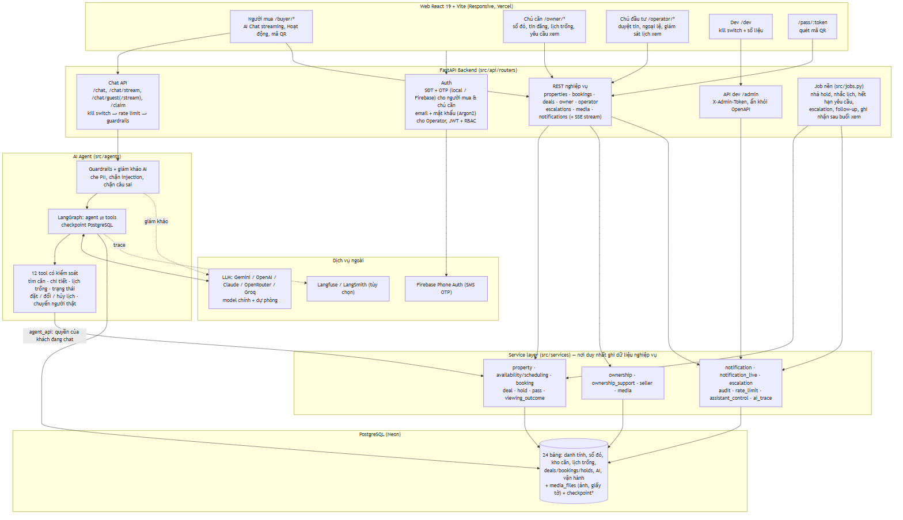
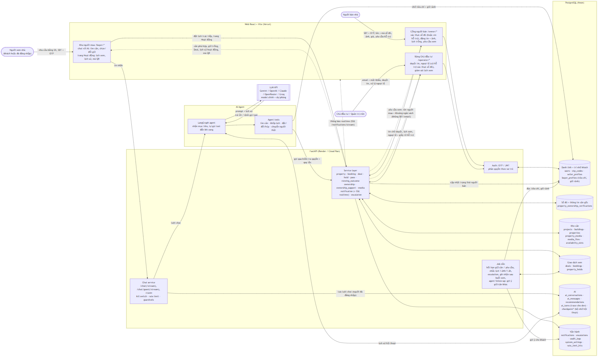
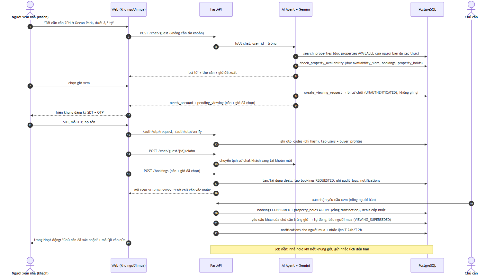
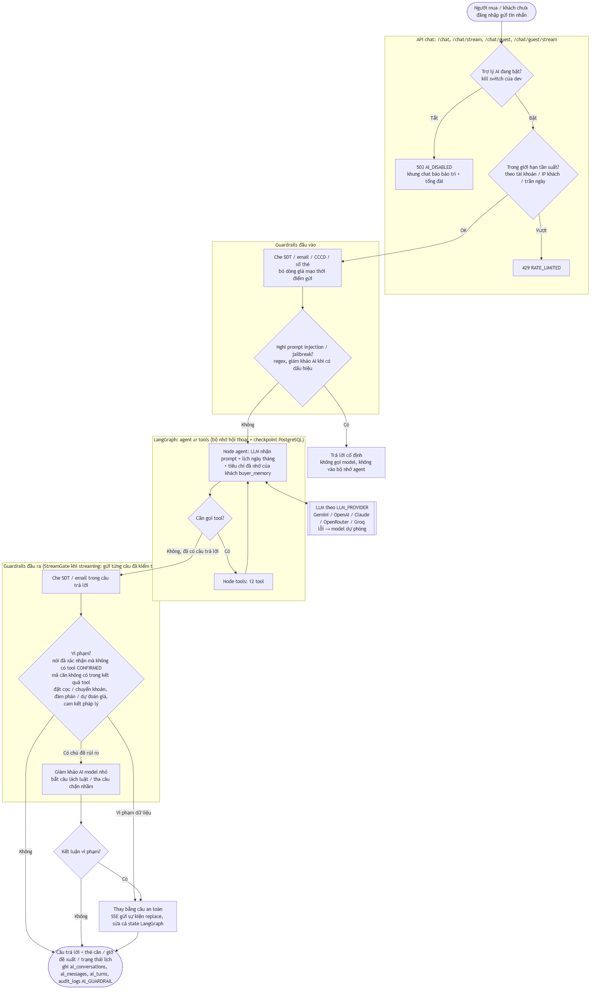
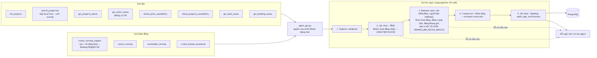
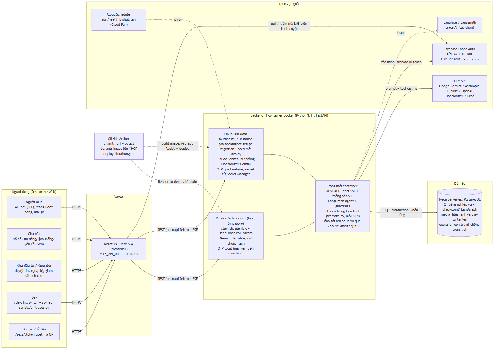

# Architecture (Deliverable #3)

Ảnh PNG/SVG xuất từ các sơ đồ Mermaid trong [`DIagram/`](../DIagram/) (nguồn chính, sửa ở đó rồi xuất lại).
Quy tắc nghiệp vụ đầy đủ: [`CLAUDE.md`](../CLAUDE.md).

## 1. Tổng thể



Web React (Vercel) gọi FastAPI qua REST + SSE. Chat đi qua kill switch → rate limit → guardrails → LangGraph agent;
agent chỉ chạm dữ liệu qua 12 tool → `agent_api` → Service layer, cùng cửa với web, nên cùng kiểm tra quyền và luật
nghiệp vụ. PostgreSQL là nguồn sự thật (cả ảnh tải lên, bộ nhớ hội thoại, trace AI). Nguồn: [`System Overview Diagram.md`](../DIagram/System%20Overview%20Diagram.md).

## 2. Luồng dữ liệu



Ai gửi gì, qua lớp nào, ghi vào bảng nào. Chiều về cổng chủ căn chỉ mang họ tên + nhu cầu người mua, không có
SĐT/email. Nguồn và bảng giải thích từng bảng: [`Data Flow Diagram.md`](../DIagram/Data%20Flow%20Diagram.md).

## 3. Luồng chính: người mới chat → đặt lịch → chủ căn xác nhận



## 4. Một lượt chat của agent





Guardrails đầu vào (che PII, chặn injection không gọi model), vòng `agent ⇄ tools` (conditional edge `tools_condition`),
guardrails đầu ra (chặn câu "đã xác nhận" khi chưa có, mã căn bịa, đặt cọc / đàm phán giá) + giám khảo AI.
Nguồn: [`Agent Flow Diagram.md`](../DIagram/Agent%20Flow%20Diagram.md).

## 5. Triển khai



Nguồn: [`Deployment Diagram.md`](../DIagram/Deployment%20Diagram.md).

## Lựa chọn công nghệ

| Lựa chọn | Lý do |
|---|---|
| LangGraph (1 agent, vòng agent ⇄ tools) | Hội thoại nhiều lượt có trạng thái, checkpoint trong PostgreSQL, streaming; không cần nhiều agent |
| SQL hard filter + soft scoring, không Vector DB | Dữ liệu căn có cấu trúc: lọc chính xác, giải thích được, không trả căn đã bán |
| PostgreSQL exclusion constraint | Chống trùng lịch ngay trong DB (theo căn cho hold, theo chủ căn cho lịch đã xác nhận), kể cả khi nhiều request đồng thời |
| Guardrails bằng code + giám khảo AI | Luật quan trọng (không bịa căn, không nói đã xác nhận, không đặt cọc) không chỉ dựa vào prompt |
| Nhiều LLM provider + model dự phòng | Free tier / quota hay hết; đổi provider bằng biến môi trường |

## Xuất lại ảnh

```bash
# trong một thư mục tạm có @mermaid-js/mermaid-cli; trích khối ```mermaid``` từ DIagram/*.md rồi:
npx mmdc -i system-overview.mmd -o docs/diagrams/system-overview.png -b white -s 2
```
