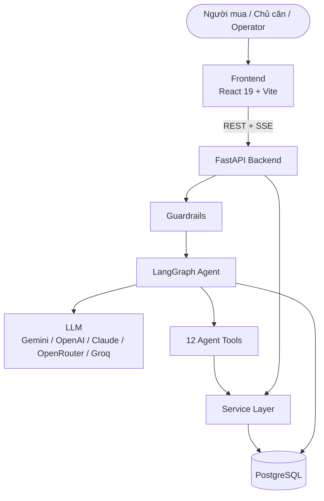
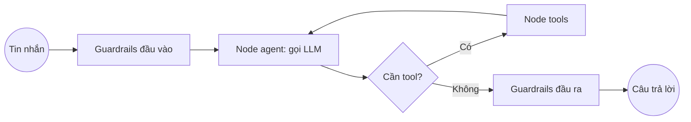

# Architecture Diagram

Bản rút gọn. Sơ đồ đầy đủ nằm trong [`DIagram/`](../DIagram/) — bắt đầu từ
[`System Overview Diagram.md`](../DIagram/System%20Overview%20Diagram.md) và [`Data Flow Diagram.md`](../DIagram/Data%20Flow%20Diagram.md).

## System Overview

## Agent Flow

## Component Details

| Component | Technology | Purpose |
|-----------|-----------|---------|
| Frontend | React 19 + Vite + TypeScript, Tailwind, TanStack Query | Web cho 3 vai trò + trang dev |
| Backend | FastAPI, Pydantic v2 | REST API, chat SSE, job nền |
| Agent | LangGraph | Điều phối agent, bộ nhớ hội thoại (checkpoint PostgreSQL) |
| LLM | Gemini / OpenAI / Claude (+ OpenRouter, Groq) | Language model, có model dự phòng |
| Database | PostgreSQL 15+ (Neon) | Source of truth, cả ảnh tải lên (`media_files`) |
| Vector Store | — | Không dùng trong MVP (recommendation = SQL hard filter + soft scoring) |
